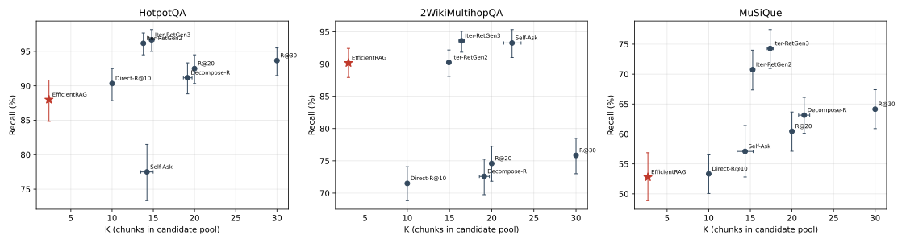
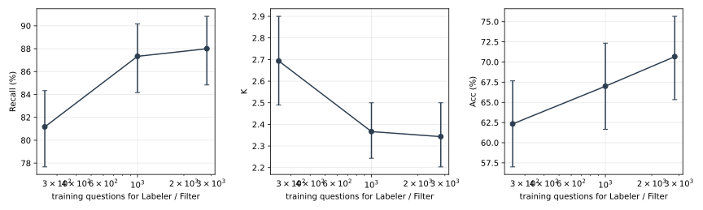

# EfficientRAG: Efficient Retriever for Multi-Hop Question Answering

Zhuang et al., 2024(arXiv:2408.04259)。多段の問いに対する反復検索で、次の問いの生成を LLM ではなく小さなエンコーダ(Labeler / Filter)にさせる手法の、小規模な再実装と縮小再現です。

## 一言でいうと

反復型の RAG(Iter-RetGen、Self-Ask など)は、検索の問いを作るたびに LLM を呼ぶので、遅く、費用もかかります。EfficientRAG は、その役目を、DeBERTa-v3-large 程度のエンコーダ 2 つに置き換えます。Labeler は、検索で得たチャンクごとに、続けて検索が要るか(`<Continue>`)、無関係か(`<Terminate>`)を判定し、答えに役立つ語を抜き出します。Filter は、元の問いと抜き出した語から、次の問いに残す語を選びます。LLM を呼ぶのは、集めたチャンクから答えを作る最後の 1 回だけです。

## 背景・課題

- 1 回の検索で足りるのは、問いに必要な情報が全部書いてある場合だけです。「KGOT 局のスタジオがあるショッピングモールの広さは」のように、途中の実体(Dimond Center)が問いに現れない多段の問いでは、1 回目の検索で得た情報から次の問いを作る必要があります。
- 既存の反復手法は、次の問いの生成や中間の答えのために LLM を何度も呼びます(論文 Table 4 で、Self-Ask は 1 問あたり 7.18 回)。遅延と費用が増え、手法ごとに、プロンプトと few-shot の例の調整も要ります。
- 論文の着眼は、多段の問いの「関係」の種類は実体に比べて少なく、関係と実体を取り出す作業は小さなモデルで足りる、という点です。
- 論文 2 章の予備実験: GPT-3.5 / GPT-4 / Llama-3-8B のどれでも、正解チャンクだけを渡した場合に比べ、無関係なチャンクが混ざると精度が下がります(図 1)。検索の精度だけでなく、渡すチャンクの量と純度が効きます。また、LLM による 1 回の分解より、反復的な分解(EfficientRAG の分解)のほうが、同じチャンク数で再現率が高くなります(図 2)。

## 提案手法

### 構成(論文 3.1、図 3)

1. 問いで検索し、上位のチャンクを得ます。
2. **Labeler & Tagger**: 入力は「問い + チャンク」です。語ごとに「残す / 捨てる」の 2 値を予測し(Labeler)、チャンク全体について `<Continue>` / `<Terminate>` を予測します(Tagger)。
3. `<Continue>` のチャンクを候補プールに加えます。`<Terminate>` のチャンクからは、枝を延ばしません。
4. **Filter**: 入力は「原問い + 集めた語(Info)」です。語ごとに、次の問いに残すか否かを予測し、残した語を並べて次の問いにします。例: 「How large is the shopping mall where KGOT radio station has its studios?」と Info「KGOT, in the Dimond Center」から、「How large is Dimond Center?」を作ります。
5. 全てのチャンクが `<Terminate>` になるか、最大の反復数に達したら止め、候補プールを生成 LLM に渡して答えを得ます。

Labeler と Filter は、同じ構造のモデル(エンコーダ、語ごとの 2 クラスの全結合層、平均プーリングしたものから tag を出す 2 クラスの全結合層)です(論文 3.3)。

### 合成データの作り方(論文 3.2)

大きな LLM(論文は Llama-3-70B-Instruct)で、次の 4 段階を行います。

1. **分解**: 多段の問いと、正解のチャンクから、チャンクごとの単一ホップの副問いに分解し、副問い間の依存関係を出します。
2. **トークンのラベル付け**: 副問いと対応するチャンクについて、答えに重要な語を二値でラベルします(語の分割は spaCy)。
3. **次の問いの生成**: 副問いと、依存先の副問いのラベル語から、次の検索の問いを作り、その語を抽出します。
4. **負例の選択**: 次の問いで検索して、最も似ているが無関係なチャンクを難しい負例とし、`<Terminate>` を付けます。他の関連チャンクは `<Continue>` です。

論文の合成データの量は、Labeler が HotpotQA で 357k、MuSiQue で 93k、2WikiMQA で 70k、Filter がそれぞれ 73k、25k、13k です(Table 1)。

## 実験と結果(論文)

設定: HotpotQA、MuSiQue、2WikiMultihopQA。検索は contriever-msmarco、生成と基準手法は Llama-3-8B-Instruct、Labeler / Filter は DeBERTa-v3-large(304M)で、GPU 4 枚で約 10 GPU 時間、AdamW、学習率 5e-6 です。基準は Direct、CoT、Direct-R(上位 10 件)、Decompose-R、Iter-RetGen(2 回、3 回)、Self-Ask です。

| 検索(論文 Table 2) | HotpotQA Recall / K | MuSiQue Recall / K | 2WikiMQA Recall / K |
|---|---|---|---|
| Direct-R@10 | 70.52 / 10 | 50.86 / 10 | 61.58 / 10 |
| Direct-R@30 | 77.05 / 30 | 60.67 / 30 | 66.91 / 30 |
| Iter-RetGen iter3 | 83.05 / 16.42 | 58.26 / 17.19 | 74.29 / 17.32 |
| Self-Ask | 73.42 / 35.27 | 60.43 / 32.36 | 88.90 / 33.68 |
| EfficientRAG | 81.84 / 6.41 | 49.51 / 6.09 | 84.08 / 3.69 |

| QA(論文 Table 3、Acc) | HotpotQA | MuSiQue | 2WikiMQA |
|---|---|---|---|
| Direct-R@10 | 44.56 | 17.12 | 32.70 |
| Iter-RetGen iter3 | 57.56 | 25.31 | 46.59 |
| Self-Ask | 42.36 | 26.97 | 55.16 |
| EfficientRAG | 57.86 | 20.00 | 53.41 |

効率(Table 4、MuSiQue の 200 問): LLM 呼び出しは、EfficientRAG 1.00 回、Iter-RetGen iter3 3.00 回、Self-Ask 7.18 回です。遅延は、EfficientRAG 3.62 秒、Direct-R 2.47 秒、Iter-RetGen iter3 9.68 秒、Self-Ask 27.47 秒です。

その他: 生成を GPT-3.5 にしても傾向は同じです(Table 5)。HotpotQA で学習して 2WikiMQA で評価する、またはその逆(Table 6)でも、Acc は同じ程度に保たれます。

論文自身が述べる弱点は、MuSiQue での低い再現率(取得するチャンクが少なすぎる)です。

## 実装メモ

- `src/efficientrag_core.py`: モデルに依存しない部分です。語ラベルと LLM が抜き出した語列の対応づけ(`align_labels`、`align_two`)、Filter の出力からの次の問いの組み立て(`assemble_query`)、反復検索のループ(`run_loop`)、負例の選択(`pick_negatives`)、学習例の組み立て(`build_examples`)、EM / F1 / Recall@K / K、ブートストラップの区間、Self-Ask の出力の解析を含みます。
- `efficientrag_mini/`: `data.py`(3 データセットの読み込み)、`synth.py`(vLLM による合成データ)、`models.py`(エンコーダ + 語ごとの head + 平均プーリングの tag head、学習、推論)、`train.py`(負例の検索と学習例の作成、学習)、`retriever.py`(bge-small-en-v1.5 による検索)、`evaluate.py`(提案手法と基準手法の評価)、`modal_app.py`(Modal での実行)、`make_report.py`(表と図)。
- 反復検索のループは、枝ごとに「問い + それまでに集めた Info の語」を持ちます。`<Continue>`(P ≥ 閾値)のチャンクだけを候補プールに足し、そのチャンクのラベル語を Info に足して Filter に渡します。既にプールにあるチャンクの枝は延ばさず、同じ問いは二度発行しません。全ての枝が止まるか、最大反復数(4)で終わります。
- 語の分割は、論文の spaCy ではなく空白区切りです。語の照合は、記号を除いて小文字にしたものの比較で、順序を保った貪欲な部分列照合です。LLM が語を足したり変えたりした場合は、照合できた語の割合が 0.6 未満の例を捨てます。
- Filter の出力は、質問側の語、続いて Info 側の語の順に並べて、次の問いにします。記号だけの語(「?」など)は、ラベルの対象になりません。
- 検索は 1 回の問いにつき上位 5 件(`INFER["k"]`)、`<Continue>` の判定は確率 0.5 以上です。
- 追加した工夫は 1 つだけです。次の問いに対する負例を、論文の 1 件ではなく、正解でない上位 2 件にしました(検索の上位 5 件に、難しい負例が複数入るため)。
- テストは `python -m pytest tests`(24 件、純 Python の部分)です。

## 縮小再現の設定と結果

### 設定

| 項目 | 論文 | この実装 |
|---|---|---|
| 合成データの LLM | Llama-3-70B-Instruct | Qwen2.5-7B-Instruct(vLLM) |
| 生成・基準手法・正誤判定の LLM | Llama-3-8B-Instruct(判定は GPT-3.5) | Qwen2.5-7B-Instruct(判定も同じ LLM) |
| Labeler / Filter のエンコーダ | DeBERTa-v3-large | 同じ(microsoft/deberta-v3-large) |
| 検索 | contriever-msmarco | bge-small-en-v1.5(コサイン類似度) |
| 検索の対象 | 各データセットの文書集合 | 開発データの 2,000 問の候補段落(重複を除く。HotpotQA 19,330、2WikiMQA 11,687、MuSiQue 18,592 段落) |
| 学習の質問数(合成に使う) | 数万問(Labeler の例が 357k など) | HotpotQA 3,000、2WikiMQA 1,500、MuSiQue 1,500 問(分解に成功したのは 2,820 / 1,448 / 1,298 問) |
| Labeler の例数 / Filter の例数 | 357k / 73k(HotpotQA) | 14,256 / 909(HotpotQA)、9,141 / 867(2WikiMQA)、7,104 / 493(MuSiQue) |
| 学習 | 学習率 5e-6、約 10 GPU 時間 | 学習率 2e-5、バッチ 16、3 エポック、bf16。HotpotQA の全量で、Labeler が約 11 分、Filter が約 0.5 分(VRAM 40GB の GPU) |
| 評価 | データセットの評価全体 | 開発データから無作為に 300 問ずつ(シード固定) |
| 指標 | Recall@K、K、EM、F1、Acc(GPT-3.5 判定) | 同じ。ただし Acc の判定は Qwen2.5-7B-Instruct |

データは、HotpotQA が `hotpotqa/hotpot_qa`(distractor)、2WikiMultihopQA が `framolfese/2WikiMultihopQA`、MuSiQue が `dgslibisey/MuSiQue`(answerable のみ)で、いずれも Hugging Face から取得できました。

基準手法は、Direct、CoT、Direct-R(上位 10 / 20 / 30)、Decompose-R(論文 Table 11 の分解プロンプト、副問いごとに上位 10 件)、Iter-RetGen(2 回、3 回。毎回上位 10 件、次の検索の問いは「原問い + 直前の生成の thought」)、Self-Ask(副問いごとに上位 10 件、中間の答えは検索したチャンクから LLM が生成、最大 4 回)です。Iter-RetGen と Self-Ask は、論文のコードではなく、論文の記述に沿って自分で書いたものです。プロンプトの一部(Direct と CoT の例、分解、判定)は論文の付録と同じで、他は自分で書きました。

### 実行

```bash
python -m pytest tests                                  # テスト(24 件)
modal run --profile modal-lab efficientrag_mini/modal_app.py --stage prepare --datasets hotpotqa,2wiki,musique
modal run --profile modal-lab efficientrag_mini/modal_app.py --stage synth   --datasets hotpotqa,2wiki,musique
modal run --profile modal-lab efficientrag_mini/modal_app.py --stage fit     --datasets hotpotqa --sizes 250,1000,0   # 0 = 全量
modal run --profile modal-lab efficientrag_mini/modal_app.py --stage fit     --datasets 2wiki,musique --sizes 0
modal run --profile modal-lab efficientrag_mini/modal_app.py --stage eval    --datasets hotpotqa     # 2wiki / musique も同様
python efficientrag_mini/make_report.py                 # docs/tables.md と図
```

結果は `efficientrag_mini/results/eval_<データセット>.json`(質問ごとの記録)、`fit_*.json`、`synth_*.json` に保存されます。以降の数値はすべてこれらから `make_report.py` が計算したもので、全表は [docs/tables.md](docs/tables.md) にあります。区間は、質問単位のブートストラップ(10,000 回)による 95% 区間です。

### 合成データの品質

Qwen2.5-7B-Instruct による分解は、プロンプトに「副問いはチャンクの数と同数、各チャンクをちょうど 1 回使う」と例を入れ、失敗した問いを温度 0.8 で最大 2 回作り直しても、HotpotQA の 3,000 問のうち 180 問(6.0%)、2WikiMQA の 1,500 問のうち 52 問(3.5%)、MuSiQue の 1,500 問のうち 202 問(13.5%)で、チャンクとの対応が崩れて捨てました(`synth_*.json`)。最初のプロンプト(例なし)では、40 問中 13 問しか有効になりませんでした。続いて、抜き出された語を元のチャンクの語に対応づけられなかった副問いを捨てた結果、Labeler の正例は HotpotQA で 4,752 件(捨てたのが 652 件)、MuSiQue で 2,368 件(429 件)でした。MuSiQue のほうが、語の照合に失敗する割合が高く、LLM が 7B と小さいことと、段落が長いことが影響していると思われます(原因の切り分けはしていません)。Filter の学習例は、依存のある副問いからだけ作られるため、論文の比(Labeler の約 2 割)より小さい約 6% でした。

### 結果(HotpotQA、評価 300 問)

検索と QA(Acc は Qwen2.5-7B-Instruct による判定)。`[a, b]` は 95% 区間です。

| 手法 | Recall (%) | K | LLM 呼び出し/問 | Acc (%) |
|---|---|---|---|---|
| Direct-R@10 | 90.3 [87.8, 92.7] | 10.00 | 1 | 61.0 [55.7, 66.3] |
| Direct-R@30 | 93.7 [91.7, 95.5] | 30.00 | 1 | 61.7 [56.0, 67.0] |
| Iter-RetGen iter3 | 96.7 [95.0, 98.2] | 14.80 [14.52, 15.09] | 3 | 67.0 [61.7, 72.3] |
| Self-Ask | 77.5 [73.3, 81.7] | 14.23 [13.45, 14.99] | 4.55 | 58.0 [52.3, 63.7] |
| EfficientRAG | 88.0 [85.0, 90.8] | 2.34 [2.20, 2.50] | 1 | 70.7 [65.3, 75.7] |

### 結果(2WikiMultihopQA と MuSiQue、評価 各 300 問)

| 手法 | 2Wiki Recall / K | 2Wiki Acc | MuSiQue Recall / K | MuSiQue Acc |
|---|---|---|---|---|
| Direct-R@10 | 71.5 [68.8, 74.2] / 10 | 38.0 [32.7, 43.3] | 53.3 [50.1, 56.5] / 10 | 16.3 [12.0, 20.7] |
| Iter-RetGen iter3 | 93.6 [91.8, 95.2] / 16.44 | 57.0 [51.3, 62.7] | 74.3 [71.0, 77.4] / 17.39 | 32.0 [26.7, 37.3] |
| Self-Ask | 93.2 [91.0, 95.3] / 22.42 | 48.0 [42.3, 53.7] | 57.1 [52.8, 61.4] / 14.37 | 15.7 [11.7, 20.0] |
| EfficientRAG | 90.2 [87.8, 92.4] / 3.03 [2.85, 3.22] | 53.0 [47.3, 58.7] | 52.8 [48.9, 56.7] / 2.70 [2.47, 2.93] | 21.7 [17.0, 26.3] |

反復数の平均は、HotpotQA 2.30、2WikiMQA 2.68、MuSiQue 2.23 でした(論文は MuSiQue で 2.73)。



### 効率(HotpotQA の 30 問を 1 問ずつ処理。vLLM を使った LLM、検索、エンコーダを通した実時間)

| 手法 | LLM 呼び出し/問 | 遅延の平均 (s) | 95% 区間 |
|---|---|---|---|
| Direct-R@10 | 1.00 | 0.22 | [0.20, 0.23] |
| EfficientRAG | 1.00 | 0.40 | [0.37, 0.44] |
| Iter-RetGen iter3 | 3.00 | 2.78 | [2.57, 3.01] |
| Self-Ask | 4.20 | 1.77 | [1.48, 2.10] |

EfficientRAG は Iter-RetGen iter3 より 86%(差 2.38 s [2.17, 2.61])、Self-Ask より 77%(差 1.36 s [1.09, 1.68])短く、Direct-R@10 の 1.84 倍でした。

### 論文の主張との対応

「差なし」は、ブートストラップの区間が 0 をまたぐという意味で、同等であることの証明ではありません(300 問では、Acc で ±5 ポイント程度の差は検出できません)。

| 論文の主張 | 結果 | 判定 |
|---|---|---|
| (a) 同程度の再現率を、最も少ないチャンク数で得る。HotpotQA は Recall 81.84 / K=6.41 で、Direct-R@10(70.52)を上回り、Iter-RetGen iter3(83.05)と同程度 | K は全データセット・全基準手法より少なく(HotpotQA 2.34、2WikiMQA 3.03、MuSiQue 2.70。差の区間は全て 0 より小さい)。Recall は、2WikiMQA で Direct-R@10 を +18.7 [+15.4, +21.9] 上回り、Iter-RetGen iter2 と差なし(−0.1 [−3.0, +2.9])、MuSiQue で Direct-R@10 と差なし(−0.6 [−3.8, +2.7])。HotpotQA では Direct-R@10 と差なし(−2.3 [−5.2, +0.5])で、Iter-RetGen iter3 より低い(−8.7 [−11.3, −6.0]) | K の少なさは再現できた。Recall が Direct-R@10 を上回る点は、2WikiMQA のみ再現でき、HotpotQA では再現できなかった(差なし)。Iter-RetGen との同等性は、2WikiMQA の iter2 のみ |
| (a') MuSiQue では再現率が低い(49.51 / K=6.09) | Recall 52.8、Iter-RetGen iter3 に −21.5 [−24.9, −18.0] | 同じ弱点を再現できた |
| (b) QA の精度が、LLM ベースの反復手法に近い。HotpotQA と 2WikiMQA では最高、MuSiQue では劣る | Acc の差(EfficientRAG − Iter-RetGen iter3): HotpotQA +3.7 [−1.0, +8.0]、2WikiMQA −4.0 [−9.3, +1.3]、MuSiQue −10.3 [−15.3, −5.3]。Direct-R@10 に対しては、全データセットで上回る(+9.7、+15.0、+5.3)。Self-Ask に対して、HotpotQA +12.7 [+6.7, +18.7]、MuSiQue +6.0 [+1.0, +11.0] で上回り、2WikiMQA は差なし(+5.0 [−1.3, +11.3]) | HotpotQA と 2WikiMQA は「Iter-RetGen と差なし」で、近いという主張は再現できた。2WikiMQA で最高になる点は再現できなかった(点推定は下)。MuSiQue で劣る点は再現できた |
| (c) LLM 呼び出しが 1 回で、速い | 呼び出しは 1.00 回(Iter-RetGen iter3 は 3.00、Self-Ask は 4.2〜6.1)。遅延は Iter-RetGen iter3 より 86% 短く、Self-Ask より 77% 短い(論文は 60〜80%) | 再現できた。ただし、測定したのは HotpotQA の 30 問で、論文は MuSiQue の 200 問です。絶対値の秒数は、実行環境が違うので比較できません。GPU 使用率は測っていません |
| (d) Labeler と Filter のアブレーション(論文に表はない) | Filter なし(原問い + Info の語を単純に連結): Filter なしとの Acc の差(Filter なし − 標準)は、HotpotQA −3.0 [−6.3, +0.3]、MuSiQue +0.3 [−3.0, +3.7]、2WikiMQA +4.3 [+0.3, +8.3] で、2WikiMQA では Filter なしのほうが良く、他は差なしです。tag なし(全チャンクをプールに入れる): K が +6.4〜+9.5 増え、Recall は +3〜+13 上がる一方、Acc は 2WikiMQA で −8.7 [−13.3, −3.7]、HotpotQA で −4.0 [−7.7, 0.0]、MuSiQue で +1.0 [−3.3, +5.3] | Tagger(`<Continue>` / `<Terminate>`)は、K を 1/3〜1/4 に減らしつつ、Acc を保つ(2WikiMQA では上げる)ので、効果を確認できた。Filter は、この設定では効果を確認できなかった |

### データ量と精度(HotpotQA、Labeler と Filter の学習に使う質問数)

| 学習の質問数 | Labeler / Filter の例数 | Recall (%) | K | Acc (%) |
|---|---|---|---|---|
| 250 | 1,239 / 75 | 81.2 [77.8, 84.3] | 2.69 | 62.3 [56.7, 67.7] |
| 1,000 | 5,022 / 320 | 87.3 [84.3, 90.3] | 2.37 | 67.0 [61.7, 72.3] |
| 2,820 | 14,256 / 909 | 88.0 [85.0, 90.8] | 2.34 | 70.7 [65.3, 75.7] |

250 問から 1,000 問に増やすと、Recall は +6.1 ポイント、Acc は +4.7 ポイント上がります。1,000 問から 2,820 問では、Recall は +0.7 ポイント(差の区間は [−1.3, +2.7])で頭打ちに近く、Acc は +3.7 ポイント(差の区間は [+1.0, +6.3])です(`docs/tables.md` の「各条件 − EfficientRAG」の符号を反転)。学習は 1 回(シード 1 つ)で、条件間のばらつきは見ていません。



### 設定の感度(HotpotQA)

検索の件数 k = 3 / 5 / 10 で Recall は 86.0 / 88.0 / 90.7、K は 2.11 / 2.34 / 2.86 です。閾値 0.3 / 0.5 / 0.7 では Recall が 88.0 / 88.0 / 85.3 で、Acc の差は区間に 0 を含むものがほとんどです。値は標準(k=5、閾値 0.5)で固定し、評価データで調整していません。

### 分かったこと

- 論文の主張のうち、「`<Continue>` のチャンクだけを集めるので K が小さい」「LLM 呼び出しが 1 回で速い」「QA の精度が LLM ベースの反復手法に近い」は、小さな LLM と小さな学習データ(論文の 1/25 以下)でも成り立ちました。
- 一方、「再現率で Direct-R や反復手法を上回る」は、データセットによります。HotpotQA では、候補段落 19,330 の小さなコーパスで Direct-R@10 がすでに 90.3% あり、上回る余地が小さい点に注意が要ります(論文は 70.52%)。この再現のコーパスは、論文より検索が易しいです。
- Filter(次の問いの語選び)は、合成データが 493〜909 例と少ない設定で、原問いに Info の語を連結するだけの方法と、同等かそれ以下でした。論文は Filter の単独の効果を示していないので、この点は「論文の主張を支持も否定もしない」結果です。
- 学習の質問数を 250 から 1,000 に増やすと、精度が大きく上がり、その先は緩やかでした(上の表)。

### この実装がカバーしない範囲

- 論文の LLM(Llama-3-70B で合成、Llama-3-8B で生成、GPT-3.5 で判定)、contriever-msmarco、spaCy は使っていません。LLM が違うため、絶対値は論文と比べられません。比較するのは、手法間の差と傾向です。
- 合成データの量は論文の 1/25 以下(Labeler)、1/80 以下(Filter)で、学習率も違います(5e-6 に対し 2e-5)。
- 検索コーパスは、評価の 300 問を含む開発データ 2,000 問の候補段落(約 1.2〜1.9 万)で、論文の設定(全文書)より小さいです。
- 評価は各 300 問、学習は 1 回(シード 1 つ)です。シード間のばらつきは測っていません。
- Acc の判定は、生成と同じ Qwen2.5-7B-Instruct で、GPT-3.5 の判定とは一致しない可能性があります。判定の誤りは測っていません。
- Self-Ask の EM と F1(HotpotQA で 5.7% と 21.6%)は低いです。最終の答えが、短い語句ではなく文になる場合が多く、解析も「So the final answer is」の形のみを拾うためです。Acc(判定は文でも正誤を見る)の比較のほうが公平で、EM と F1 は参考になりません。論文の実装とも異なります。この点の修正と再実行はしていません。
- Iter-RetGen と Self-Ask のプロンプトは論文のものではありません(論文の付録の一部しか、抽出したテキストに含まれていません)。
- 遅延は 30 問の実時間で、GPU 使用率と、論文の MuSiQue の 200 問での測定は再現していません。
- 論文の 5.3(生成を GPT-3.5 にする)と 5.4(データセット間の転移)は実施していません。
- Labeler の語ラベルの精度、Tagger の判定の精度を単独で測っていません(下流の Recall と K だけ)。

## 所感・疑問点

- 検索の対象が小さいコーパスだと、Direct-R@10 の Recall がすでに高く(HotpotQA 90.3%)、手法間の Recall の差が見えにくくなります。論文の HotpotQA(Direct-R@10 が 70.52%)と同じ難しさにするには、全文書を対象にする必要があります。
- 論文は、EfficientRAG がチャンクを少なく取ることで、LLM が惑わされにくくなると説明します。この検証では、tag を外す(K が増える)と、2WikiMQA で Acc が下がり(−8.7)、他は有意差なしでした。説明が一貫して成り立つかは、生成 LLM の大きさにもよると思われます。
- Self-Ask の Recall は、HotpotQA で 77.5%(論文は 73.42%)と低く、自分の実装の弱さか、副問いの質か、切り分けられていません。
- Filter が効かなかった原因が、データ量(909 例)なのか、LLM の質(7B)なのか、手法の限界なのかは、この実験では切り分けていません。Filter の学習例を増やす(依存のない問いにも次の問いを作る、質問数を増やす)追試が有効だと思います。

## 参考

- Ziyuan Zhuang et al., "EfficientRAG: Efficient Retriever for Multi-Hop Question Answering", 2024. https://arxiv.org/abs/2408.04259
