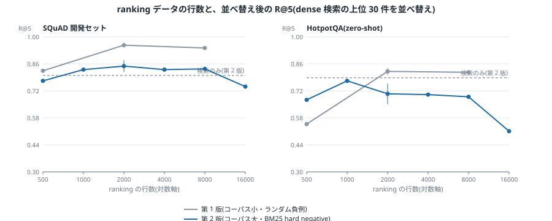
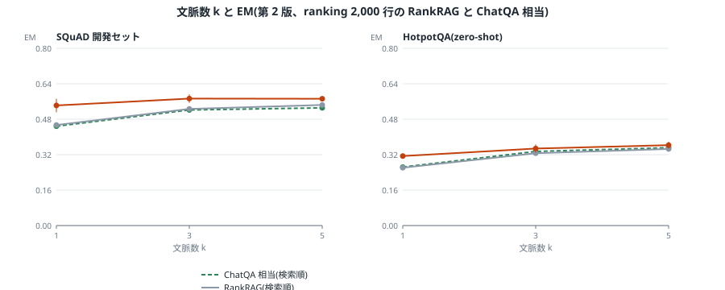
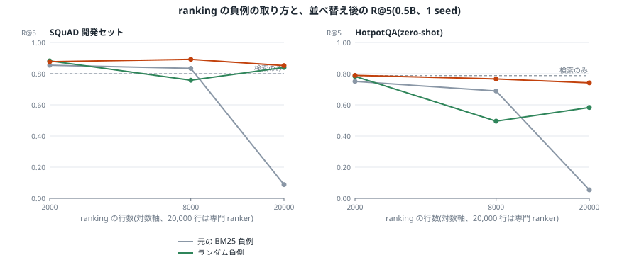

# RankRAG: Unifying Context Ranking with Retrieval-Augmented Generation in LLMs

- 著者: Yue Yu, Wei Ping, Zihan Liu, Boxin Wang, Jiaxuan You, Chao Zhang, Mohammad Shoeybi, Bryan Catanzaro (Georgia Tech / NVIDIA)
- 年: 2024 (arXiv:2407.02485, NeurIPS 2024)
- タグ: RAG, reranking, instruction-tuning, データ効率, ドメイン汎化

## 一言でいうと

RAG の「rerank 用の別モデル」を捨て、1 つの LLM に ranking と生成の両方を instruction tuning するレシピの論文です。学習ブレンドに少量 (約 50k ペア) の ranking データを混ぜるだけで、10 倍量で学習した専門 ranker を上回り、9 つの一般ベンチマークと 5 つの医療ベンチマーク (学習なし) で ChatQA-1.5 や GPT-4 を上回ります。

## 背景・課題

通常の RAG (retrieve-then-generate) には三つのつらさがあります。

- LLM は top-k 件の読みには強いが、top-100 を丸ごと読ませても精度は伸びない (Fig.1: ChatQA-1.5 は k=10 付近で飽和)。小さい k は recall 不足、大きい k はノイズ混入のトレードオフです。
- 小さい k で当てるには retriever の recall が要るが、bi-encoder の独立エンコードでは表現力不足で取りこぼします。
- 別立ての ranker (BERT/T5 系) を挟む手はあるが、LLM 本体ほどのゼロショット汎化はなく、パイプラインも重くなります。

## 提案手法

二段階ファインチューニングで、単一 LLM に二役をさせます。

- Stage-I (SFT): 会話・ELI5・Self-Instruct 等の高品質 instruction データ 128K 件で素振り (batch 128, 1000 steps, lr 5e-6)。
- Stage-II (統一 instruction tuning): 次の 5 種をすべて同じ (x=質問, c=文脈, y=答え) 形式に畳んで学習します (batch 64, 3300 steps ≒ 1 epoch, lr 3e-7 (8B) / 2e-7 (70B))。
  1. Stage-I の SFT データ (維持用)
  2. Context-rich QA (DROP, NarrativeQA, Quoref, ROPES, NewsQA, TAT-QA、会話 QA)
  3. Retrieval-augmented QA (SQuAD + WebQuestions。各問に golden + BM25 検索の 5 文脈)
  4. Context ranking (MS MARCO の golden/ BM25 hard-negative に True/False、+ 会話 QA から 4-gram recall ≥0.5/<0.1 で作った疑似ペア。計約 50k)
  5. Retrieval-augmented ranking (SQuAD + WebQuestions の 5 文脈から関連 passage の id を列挙)

推論は retrieve-rerank-generate の三段です。(1) retriever が top-N 件 (8B: N=100、70B: N=30) を取る。(2) RankRAG が各文脈に「True を生成する確率」を relevance score として付け替え、top-k (k≪N、例 5) に絞る。(3) その top-k で答えを生成します。rerank は 1 トークン生成相当なので、N=20→100 で EM +5.9〜9.1% に対し時間は +0.9x〜6.0x に収まります (20〜100x にはならない)。

## 実験の主な結果

9 データセットのゼロショット比較です (Tab. 2、EM。TriviaQA/PopQA は EM/Acc、HotpotQA/2WikimQA は EM/F1)。

| 手法 | NQ | TriviaQA | PopQA | HotpotQA | 2WikimQA | FEVER | Doc2Dial | TopiOCQA | Inscit | Avg. |
|---|---|---|---|---|---|---|---|---|---|---|
| Llama3-Instruct 8B | 30.9 | 70.7 | 34.9 | 26.0 | 9.6 | 88.9 | 33.6 | 44.9 | 32.6 | 40.8 |
| Llama3-ChatQA-1.5 8B | 42.4 | 81.0 | 52.6 | 33.4 | 26.8 | 90.9 | 39.3 | 49.9 | 30.1 | 49.6 |
| Llama3-RankRAG 8B | 50.6 | 82.9 | 57.6 | 35.3 | 31.4 | 92.0 | 40.4 | 50.4 | 33.3 | 52.6 |
| Llama3-ChatQA-1.5 70B | 47.0 | 85.6 | 50.9 | 42.2 | 34.9 | 92.7 | 41.3 | 55.6 | 32.3 | 53.6 |
| Llama3-RankRAG 70B | 54.2 | 86.5 | 59.9 | 42.7 | 38.2 | 93.8 | 41.5 | 52.8 | 35.2 | 56.1 |
| GPT-4-0613 (RAG なし) | 40.3 | 84.8 | 31.3 | 34.5 | 29.8 | 87.7 | 27.6 | 30.1 | 27.0 | 42.0 |

- 8B でも InstructRetro 43B (5 倍) や RA-DIT 65B (8 倍) を上回り、Llama3-Instruct 70B を NQ/TriviaQA で抜きます。
- 伸びは難しいデータほど大きく、PopQA・2WikimQA では ChatQA-1.5 比 +10% 超です。
- GPT-4 に RAG を付けると逆に落ちることがあります (†: 関連文脈がないと回答拒否するため)。

アブレーションです (Tab. 3、Llama3-8B、Avg.)。RankRAG 8B 52.6 に対し、w/o reranking 49.8、w/o RQA 51.6、w/o RAR 51.8、w/ RAFT 48.1、Stage-I SFT のみ 42.2。rerank を抜くと全タスクで低下します。

ranking 性能です (Tab. 6、NQ の R@5。Dragon retriever 単体 74.9)。RankLLaMA 8B 77.8 (約 503k)、BGE-Reranker 78.0 (*)、GPT-4 79.3 に対し、RankRAG 8B は約 50k で 80.3。(*: BGE は評価タスクと重なる学習データを含むと論文に明記)。10 倍量の専門 ranker を少量データで上回ります。一方、ranking 学習なしの ChatQA-1.5 をそのまま ranker に使うと 68.2 と retriever 単体より悪化します。Fig.4 では ranking データ 5k 件 (MS MARCO の約 1%) でも十分強く、50k への増加は non-marginal な上積みです。

医療ベンチマーク Mirage です (Tab. 5、医療データでの追加学習なし)。RankRAG 8B Avg. 63.95 (ChatQA-1.5 8B 59.96、Meditron 70B に +6.3%)、RankRAG 70B Avg. 78.06 (ChatQA-1.5 70B 73.98、GPT-4 の 98% 超)。

## 実装メモ

LLM の学習は重いので、このリポジトリでは範囲を絞り、**主張の向きを合成データで確かめる小規模実装**を `src/rankrag_small.py` に置きました。依存は numpy のみです。

```bash
python -m venv .venv && source .venv/bin/activate
pip install -r requirements.txt
python src/rankrag_small.py
```

実装の対応関係は次のとおりです。

| 関数 | 対応する主張 |
|------|--------------|
| `exp_rerank_gain` | Tab.3: 生成時 top-k を rerank 順にする vs retriever 順のまま (w/o reranking) |
| `exp_data_efficiency` | Tab.6 + Fig.4: 少量+統一学習の scorer vs 10 倍量の ranking-only 専門 scorer vs 未学習 ranker |
| `exp_topn_tradeoff` | Fig.1 対 §5.5: k を変えたときの EM。rerank ありは小さい k で飽和 |

合成の仕掛けは `make_corpus` に集約しています。各 passage は `s_lex` (語彙っぽい信号)、`s_dense` (retriever が使う弱い bi-encoder 信号)、`s_ans` (答えの有無の oracle。統一 (x,c,y) 学習で ranking head が触れるという転移の代理、仮定) を持ちます。生成 EM の代理は「golden が top-k 内 AND top-k 内 distractor に誤らされない (1 件あたり確率 0.03、仮定)」です。

実行結果は次のとおりです。

```
[Tab.3] rerankなし EM@5: 0.132 (DEGENERATE)
[Tab.3] rerankあり EM@5: 0.658 / 改善: +0.527
[Tab.6] backbone retriever R@5: 0.146
[Tab.6] 未学習 ranker R@5: 0.044 (DEGENERATE、backbone を下回る)
[Tab.6] 専門 ranker(10x量) R@5: 0.341
[Tab.6] 統一学習(1x量) R@5: 0.732
[Fig.1/6] k= 1: rerankなし 0.037 <- DEGENERATE(小さい k で崩壊) / rerankあり 0.451
[Fig.1/6] k= 2: rerankなし 0.062 <- DEGENERATE(小さい k で崩壊) / rerankあり 0.569
[Fig.1/6] k= 5: rerankなし 0.117 / rerankあり 0.657
[Fig.1/6] k=10: rerankなし 0.166 / rerankあり 0.656
[Fig.1/6] k=20: rerankなし 0.221 / rerankあり 0.540
```

- rerank ありは +0.527 で上回り、向きは Tab.3 (52.6 対 49.8) と同じです。絶対値は比べられません。
- 少量+統一学習 (0.732) が 10 倍量の専門 scorer (0.341) を上回り、未学習 ranker (0.044) は backbone (0.146) より悪化します。向きは Tab.6 (80.3 対 77.8、68.2 < 74.9) と同じです。ただし小規模実装の転移信号 `s_ans` が強めのため差は誇張されています。一致と言えるのは順序だけです。
- rerank ありは k=5 で飽和し、k=20 ではノイズで少し落ちます。rerank なしは k を増やしても recall がじわ伸びするだけです。向きは Fig.1 (rerank なしの飽和) と §E.2 (rerank 後は k=5 で十分) と同じです。

### この実装がカバーしない範囲

- LLM のファインチューニングそのもの (Llama3-8B/70B) や、9+5 ベンチマークでの再現はしていません。
- 学習ブレンド比 (Appendix B) の再現や、最適な ranking データ量の探索はしていません。
- Fig.5 の時間効率カーブや、DPR/Contriever 違い (Fig.3) の再現はしていません。
- 医療ドメインへのゼロショット汎化 (Tab.5) は対象外です。

## Modal での縮小再現(SQuAD / MS MARCO × Qwen2.5、`rankrag_mini/`)

論文の推論(retrieve 上位 30 件 → 同じモデルで rerank → 上位 k 件で生成)と、Stage-II の学習ブレンドを、小型モデルで再現する実験です。別の言い方をすると、「1 つのモデルに ranking を混ぜて学習すると、rerank の質と生成の質はどうなるか」を調べます。

### 設定

- モデル: Qwen2.5-0.5B-Instruct(主)と 1.5B-Instruct。LoRA(r=32、alpha=64、全線形層)。bf16 の autocast で、LoRA の重みは fp32。AdamW(0.9, 0.98)、lr 2e-4、batch 32、1 epoch
- 学習ブレンド(論文 §4.2 の 5 種のうち、QA、RQA、RAR、context ranking の 4 種。Stage-I の SFT データは使いません)

| 種別 | 内容 | 行数(主条件) |
|---|---|---|
| QA | SQuAD と HotpotQA を半々、gold 文脈つき | 4,000 |
| RQA | 10 個の候補文脈からの QA(gold と BM25 の負例) | 4,000 |
| RAR | 10 個の候補から関連 passage の番号を列挙 | 2,000 |
| context ranking | MS MARCO v1.1 の gold と、BM25 で選んだ hard negative に True / False | 条件ごとに 500〜16,000 |

- 評価はすべてゼロショットです。SQuAD の開発セットは 20,958 passage のコーパスから 1,000 問、HotpotQA(distractor)の検証セットは 37,611 passage のコーパスから 1,000 問です。retriever は bge-small(dense)と BM25 で、上位 30 件を rerank します
- rerank のスコアは、True と False の logit 差です(論文 §4.3)
- 指標は R@5 と AUROC(gold の passage が非 gold より上に来る確率。R@5 より感度が高い)、生成の EM(上位 k 件。k = 1, 3, 5)です
- 条件は 0.5B で 20 条件超です。ranking 行数の掃引、RAR なし、RQA なし、専門 ranker(ranking のみ 20,000 行)、総数を揃えた対照、ranking のみの対照、負例の診断、1.5B の 4 条件です。主要な条件は 3 seed で回しています(学習の seed。評価データは共通)
- 条件の定義は `rankrag_mini/jobs.py`、集計は `rankrag_mini/make_figure.py` で、全表は [`docs/tables.md`](docs/tables.md) にあります

### 結果

図 1 は ranking データの行数と、rerank 後の R@5 です。図 2 は文脈数 k と EM、図 3 は負例の取り方の診断です。







主な条件の rerank 後 R@5 です(0.5B、検索のみは SQuAD 0.800、HotpotQA 0.787。平均 ± 標準偏差は 3 seed の条件のみ)。

| 条件 | SQuAD R@5 | SQuAD AUROC | HotpotQA R@5 | HotpotQA AUROC |
|---|---|---|---|---|
| 学習なし | 0.667 | 0.848 | 0.570 | 0.810 |
| ChatQA 相当(ranking なし) | 0.365 ± 0.027 | 0.627 | 0.238 ± 0.015 | 0.561 |
| RankRAG、ranking 500 行 | 0.772 | 0.877 | 0.673 | 0.843 |
| RankRAG、ranking 1,000 行 | 0.830 | 0.912 | 0.772 | 0.878 |
| RankRAG、ranking 2,000 行 | 0.848 ± 0.030 | 0.927 | 0.705 ± 0.054 | 0.851 |
| RankRAG、ranking 8,000 行 | 0.834 | 0.942 | 0.689 | 0.855 |
| RankRAG、ranking 16,000 行 | 0.742 | 0.898 | 0.511 | 0.733 |
| 2,000 行から RAR を除く | 0.667 | 0.682 | 0.586 | 0.646 |
| 2,000 行から RQA を除く | 0.864 | 0.931 | 0.709 | 0.831 |
| 専門 ranker(ranking のみ 20,000 行) | 0.134 ± 0.038 | 0.465 | 0.078 ± 0.018 | 0.341 |

生成の EM(k = 1、検索順 → rerank 順、3 seed 平均)です。

| 条件 | SQuAD | HotpotQA |
|---|---|---|
| ChatQA 相当 | 0.448 → 0.126 | 0.264 → 0.125 |
| RankRAG、ranking 2,000 行 | 0.454 → **0.542** | 0.261 → **0.314** |
| 総数を揃えた対照(8,000 行、ranking 2,000 行) | 0.441 → 0.512 | 0.258 → 0.309 |

1.5B では、RankRAG(ranking 2,000 行)の rerank 後 R@5 が SQuAD 0.919、HotpotQA 0.836 で、検索のみ(0.800、0.787)を上回ります。EM(k = 1)は SQuAD 0.494 → 0.690、HotpotQA 0.288 → 0.369 です(1 seed)。ChatQA 相当は 0.498 → 0.276、0.278 → 0.243 と悪化します。

#### 負例の診断(専門 ranker が崩れた理由)

第 2 版の最初の結果では、専門 ranker の rerank が検索の順序を逆転させていました(AUROC 0.4 前後)。ranking のみを 2,000 行学習しても同じです。第 1 版(ランダム負例)では起きなかったので、BM25 で選んだ負例が怪しいと考えました。MS MARCO では、クエリごとの上位 passage のうち、ラベルが付いているのはごく一部です。BM25 の上位には、ラベルのない関連 passage が混ざります。

そこで、負例の取り方だけを変えた対照を回しました(0.5B、1 seed)。

| 負例 | 2,000 行(RankRAG) | 8,000 行(RankRAG) | 専門 ranker(20,000 行) |
|---|---|---|---|
| 元の BM25 | 0.854 | 0.834 | 0.088 |
| ランダム(同じクエリの別 passage) | 0.882 | 0.758 | 0.840 |
| 自分の候補を除く BM25(クエリ自身の候補集合にない passage から選ぶ) | 0.877 | **0.892** | 0.852 |

(SQuAD の rerank 後 R@5。HotpotQA でも同じ向きです。全表は `docs/tables.md`)

- 専門 ranker の崩れは負例の取り方が原因で、自分の候補を除くだけで 0.088 から 0.852 に戻りました。
- 負例を直すと、ranking を増やしたときの悪化が消えました(8,000 行で 0.892)。この診断は、崩れを見てから設計したものです。主要な条件は元の負例のまま報告し、診断は別の表にしています。
- ランダム負例の 8,000 行が悪化する理由(0.758)は分かっていません。易しい負例への過学習を疑っていますが、検証していません。

### 論文との比較

一致した点(向きのみ。絶対値は比べられません)。

- ranking を学習していないモデルを ranker にすると、検索より悪化します(Tab. 6 の ChatQA-1.5 68.2 < Dragon 74.9)。ChatQA 相当で 0.365、学習なしで 0.667 です。
- 少量の ranking を混ぜると、検索を上回ります(SQuAD で 0.848、1.5B では HotpotQA でも上回る)。生成の EM も、rerank で上がります(Tab. 3 の w/o reranking)。
- ranking データが 1,000〜2,000 行で伸びが飽和する傾向は、Fig. 4(5k 件で十分)と同じ向きです。負例を直した条件では、2,000 行と 8,000 行がほぼ同じでした。
- 負例を直すと、混合学習(RankRAG)が 1/10 の ranking 量で、専門 ranker と同等以上になります(SQuAD で 0.877 / 0.892 対 0.852、HotpotQA で 0.789 / 0.766 対 0.742)。向きは Tab. 6 と同じですが、1 seed で差も小さく、確かな主張にはできません。

一致しない点、論文より強く出た点。

- 0.5B の HotpotQA では、RankRAG の rerank が検索を上回りません(0.705 対 0.787)。1.5B では上回ります。容量が足りないと考えていますが、1.5B は 1 seed です。
- RAR を抜くと、ranker として働かなくなります(AUROC 0.927 → 0.682、R@5 は学習なしと同じ 0.667)。論文の Tab. 3 では RAR の寄与は小さく(51.8 対 52.6)、ここで強く出た理由は分かりません。
- RQA を抜いても、悪化しません(0.864 対 0.848)。論文では約 1 ポイントの寄与です。1 seed で、この差は誤差の範囲です。
- ranking のみで学習した ranker は、第 2 版の負例では崩れます。これは論文の主張(専門 ranker は RankRAG に劣る)を超えた、負例の問題です。

### 限界

- 論文のモデルや規模ではありません。学習データは SQuAD、HotpotQA、MS MARCO の一部で、Stage-I の SFT も入れていません。
- 評価は 2 つのデータセット(各 1,000 問)だけです。複数 seed の条件は主要なものに限り、診断と 1.5B は 1 seed です。
- 学習なしの EM はほぼ 0 です(回答形式を学習していないため)。学習なしと他の条件の EM は比べないでください。
- 負例の診断は後付けの設計です。「負例を直せば論文どおりになる」ことの確認であって、独立した再現ではありません。
- 数値は相対比較として読んでください。

### 実行

```bash
pip install -r requirements.txt            # scipy、torch、transformers、peft など
python tests/test_core.py                   # 指標と BM25 のテスト(CPU、数秒)

modal run rankrag_mini/modal_app.py --stage prepare --v2          # データ作成(CPU、初回のみ)
modal run rankrag_mini/modal_app.py --stage smoke --v2            # 小さな学習で動作確認
modal run rankrag_mini/modal_app.py --stage run --jobs v2         # 主要 11 条件
modal run rankrag_mini/modal_app.py --stage run --jobs v2seeds    # seed 違い
modal run rankrag_mini/modal_app.py --stage run --jobs v2b        # 対照と 1.5B
modal run rankrag_mini/modal_app.py --stage prepare-rankvar       # 診断用の負例データ
modal run rankrag_mini/modal_app.py --stage run --jobs v2c        # 診断の 6 条件
python rankrag_mini/make_figure.py                                # docs/ の図と表を作る
```

結果は `rankrag_mini/results/<条件名>.json` に保存されます。`modal run` のローカルプロセスを kill すると、リモートの実行もキャンセルされます。完了まで生かしておいてください。GPU 料金は Modal のアカウントにかかります。VRAM 12GB のローカル GPU では、`rankrag_mini/run_local.py` で 0.5B の 1 条件を試せます(勾配チェックポイント使用)。

## 補助実験: gold 文脈つきの HotpotQA 縮小再現(`gold_context_mini/`)

Tab.3 (w/o reranking で低下) と Tab.6/Fig.4 (ranking データが多いほど ranking が良くなる) を小型モデルで確かめる縮小再現です。コードは `gold_context_mini/` にあります。

#### 設定

- モデル: Qwen2.5-0.5B-Instruct + LoRA (r=16, lr 2e-4, 2 epoch)。容量仮説の検証用に Qwen2.5-1.5B-Instruct (qa_only / rank_full のみ) も追加。Qwen2.5-3B-Instruct (同2条件のみ) は lr 2e-4 で生成が縮退したため (診断記録は `results_diag/`)、下表は lr 1e-5 での再走 (タグ 30b15) の値です。旧lr分 (タグ 30b) は参考として残置します
- データ: HotpotQA distractor。取得元 (curtis.ml.cmu.edu) が名前解決できないため、HF Hub キャッシュから固定 subset を切り出した `data_seed.json` (train 8000 / validation 300) を同梱し、seed 別に train 4000 / test 250 (v2。v1 は test 150) を作ります。1 問につき gold 2 + distractor 8 の 10 文脈 (10 件未満の例は除外)
- 比較する 7 条件 (backbone retriever は語彙 overlap の弱順序。生成は top-3 文脈。括弧内は学習行数)
  - `qa_only`: 生成のみ 4000 行 (ranking データ 0)
  - `rank_small`: 生成 4000 + ranking 400 件 (論文の少量+統一の代理)
  - `rank_full`: 生成 4000 + ranking 4000 件 (1:1)
  - `specialist`: ranking のみ 8000 件 (別立ての専門 ranker の代理。生成は未学習)
  - `rankonly4k`: ranking のみ 4000 件 (rank_full と ranking 量マッチ。QA→ranking 転移の対照)
  - `mix_matched10`: QA 3600 + ranking 400 件 = 4000 行 (qa_only と総量マッチ)
  - `mix_half`: QA 2000 + ranking 2000 件 = 4000 行 (総量マッチの 1:1 混合)
- seeds 0,1,2 の 3 seed で走らせ、平均±SD (不偏標準偏差) で報告します。同 seed の再実行でも GPU の非決定性で小数点以下 2 桁目がぶれるため、単一 seed の比較に意味はありません
- rerank スコアは True/False の最終位置 logit 差です。ranking 指標に recall@3 と AUROC (gold 文書スコア群 vs distractor 群の分離度。recall@3 より感度が高い) を併用します
- Modal では bf16 で学習します (fp16 では loss=nan が頻発したため。一部バッチの nan は残るが学習は継続し、最終評価は正常)

#### 実行

計算の本体は `core.py` で、Modal とローカルで同じコードが動きます。`modal_app.py` は Modal につなぐ薄いラッパーです。

```bash
modal run gold_context_mini/modal_app.py --stage prepare   # データ作成 (CPU)
modal run gold_context_mini/modal_app.py --stage train     # 学習+評価 (全条件を 6 本ずつ並列)
```

`--kinds rank_small,rank_full` のように条件を絞れます。注意: `modal run` のローカルプロセスを kill するとリモートの実行もキャンセルされます。完了までクライアントを生かしておくこと。

ローカルで動かす場合 (試運転向け。本番規模は Modal 推奨):

```bash
pip install -r gold_context_mini/requirements-local.txt
python gold_context_mini/run_local.py --smoke              # 試運転 (train 32 / test 8 / 1 epoch)
python gold_context_mini/run_local.py                      # 本番規模 (train 1000 / test 150 / 2 epoch)
```

データは `gold_context_mini/data/`、結果は `gold_context_mini/results/rankrag_*_local.json` に保存されます。

試運転の実行例: 3 条件とも学習・評価が通りました。EM はすべて 0.000 (規模が小さすぎて生成が当たらない) ですが、recall@3 は qa_only 0.312→0.750、rank_small/rank_full 0.312→0.875 と reranked が上回り、動作確認の記録としています。

#### 結果 (v2: test 250 件、3 seed 平均±SD)

0.5B の結果です。EM は norerank → reranked、recall@3 と AUROC は reranked の値です。

| kind | 学習行数 | norerank EM | reranked EM | reranked recall@3 | reranked AUROC |
|---|---|---|---|---|---|
| qa_only | 4000 | 0.077±0.045 | 0.101±0.031 | 0.501±0.021 | 0.587±0.008 |
| rank_small | 4400 | 0.101±0.009 | 0.136±0.003 | 0.845±0.015 | 0.885±0.015 |
| rank_full | 8000 | 0.027±0.005 | 0.055±0.029 | 0.919±0.001 | 0.944±0.003 |
| specialist | 8000 | 0.000±0.000 | 0.000±0.000 | 0.936±0.006 | 0.955±0.002 |
| rankonly4k | 4000 | 0.003±0.002 | 0.001±0.002 | 0.925±0.010 | 0.946±0.010 |
| mix_matched10 | 4000 | 0.059±0.017 | 0.072±0.006 | 0.821±0.084 | 0.861±0.044 |
| mix_half | 4000 | 0.069±0.041 | 0.125±0.069 | 0.909±0.012 | 0.937±0.004 |

1.5B の結果です (qa_only / rank_full のみ)。

| kind | norerank EM | reranked EM | reranked recall@3 | reranked AUROC |
|---|---|---|---|---|
| qa_only | 0.096±0.009 | 0.147±0.018 | 0.599±0.018 | 0.651±0.008 |
| rank_full | 0.116±0.043 | 0.169±0.073 | 0.944±0.003 | 0.960±0.002 |

結果は `gold_context_mini/results/rankrag_*_05b_mini.json` (0.5B)、`rankrag_*_15b_mini.json` (1.5B) に保存してあります。タグなしの `*_mini.json` は v1 (test 150、単一 seed) の記録として残してあります。

#### 論文との比較

一致した点 (向きのみ。絶対値は比べられません)。
- 全生成 kind・両サイズで reranked EM が norerank EM を上回ります。Tab.3 (w/o reranking で全タスク低下) と同じ向きです。
- AUROC は qa_only 0.59 → mix_matched10 0.86 / rank_small 0.89 → rank_full 0.94 ≒ rankonly4k 0.95 ≒ specialist 0.96 と単調に上がります。ranking データが多いほど ranking が良くなる向きは Tab.6/Fig.4 と同じです。qa_only の AUROC がほぼ chance (0.59) なのは、ranking 未学習では scorer になっていない証拠です。

一致しない点・留保。
- QA→ranking の転移は見えません。rankonly4k (AUROC 0.946) と rank_full (0.944) は同等で、QA 混じりの上積みはありません。
- ranking→生成の転移は適量依存です。1 割混じり (rank_small、mix_matched10) は生成 EM を下げず、総量マッチ対照 (mix_matched10 対 qa_only) でも EM 差は誤差範囲です。一方 5 割以上 (rank_full の norerank 0.027) は生成を有意に下げます。0.5B では容量の取り合いが支配的です。
- 容量を上げると向きが変わります。1.5B では rank_full が qa_only を生成・ranking ともに上回り (norerank 0.116 対 0.096、AUROC 0.960 対 0.651)、論文の「統一学習で相互に高め合う」と同じ向きが出ます。ただし EM 差は誤差と重なり、有意とは言えません。
- 「ranking 未学習モデルを ranker に使うと悪化」(Tab.6 の 68.2 < 74.9) は再現しません。backbone が語彙 overlap と弱すぎて、学習済み scorer なら何でも上回るためです。ただし qa_only の rerank (recall 0.44→0.50) は学習済み ranker (0.9 超) より大幅に弱く、序列としては論文と整合します。

#### 気づいた点

- rank_full の生成は passage の丸写しっぽい冗長回答になりがちです (正解 Larnelle Harris に対し、来歴の長文をそのまま出す例など)。ranking 行の混入で回答形式が崩れます。
- seed 間のばらつきが大きく、単一 seed では結論にならない例がありました (mix_matched10 seed2: EM 改善なし、recall 0.70、AUROC 0.80)。3 seed 平均化で解消しています。

#### この再現がカバーしない範囲

- Llama3-8B/70B、9+5 ベンチマーク、MS MARCO、実 retriever、医療汎化はなし。
- 別立ての専門 ranker との対決はなし。small/full は同一モデル内の ranking 量比較のみです。

## 所感

- 「ranking を QA 形式に畳むと少量データで効く」が核で、Tab. 6 の 50k 対 503k が一番の売りです。小規模でも、少量の ranking で検索を上回る向きは確かめられました。
- 一方で、ranking の学習データの質(負例にラベルなしの関連 passage が混ざること)が、結果を大きく左右しました。論文は MS MARCO の hard negative を使いますが、同じ作り方を小規模に当てはめると、専門 ranker は崩れました。再現するときは、負例の取り方に注意が要ります。
- 実務的には「rerank は 1 トークン相当で N=100 でも +0.9x〜6.0x」の計測が有用です。LLM rerank のコスト感の目安になります。

## ディレクトリ構成

| パス | 内容 |
|---|---|
| `src/rankrag_small.py` | 合成データによる主張の向きの確認(numpy のみ) |
| `src/rankrag_core.py`、`tests/` | プロンプト、指標、BM25 と、そのテスト |
| `rankrag_mini/` | SQuAD / MS MARCO の縮小再現(第 2 版。この README の主な結果) |
| `gold_context_mini/` | gold 文脈つき HotpotQA の縮小再現(補助実験) |
| `docs/` | 図と全表 |

## 参考

- 論文: https://arxiv.org/abs/2407.02485
- 紹介記事 (Hugging Face paper page): https://huggingface.co/papers/2407.02485
