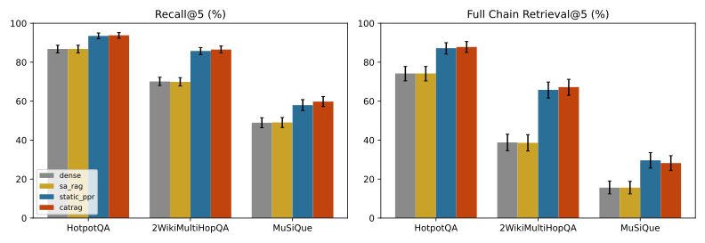

# CatRAG: Breaking the Static Graph — Context-Aware Traversal for Robust Retrieval-Augmented Generation

- 著者: Kwun Hang Lau, Fangyuan Zhang, Boyu Ruan, Yingli Zhou, Qintian Guo, Ruiyuan Zhang, Xiaofang Zhou (Huawei Hong Kong Research Center / 香港科技大学 / 香港中文大学(深圳))
- 年: 2026 (arXiv:2602.01965)
- タグ: RAG, GraphRAG, HippoRAG 2, Personalized PageRank, multi-hop QA, 検索の完全性

## 一言でいうと

HippoRAG 2 は、知識グラフ上で Personalized PageRank (PPR) を走らせて段落を検索します。この論文は、辺の重みが索引時に固定されている点(Static Graph Fallacy)が、多段の質問で取りこぼしの原因になると主張します。そこで、質問ごとに PPR の起点と辺の重みを変える 3 つの部品を足した CatRAG を提案します。報告では、4 つの多段ベンチマークで HippoRAG 2 を上回り、とくに「正解の支持段落が全部そろう割合」(Full Chain Retrieval、FCR)が伸びます。

この README は、LLM を使わずにこの主張を小規模に確かめた記録です。結論を先に書くと、**部品のうち Symbolic Anchoring の効果は再現できました。Query-Aware Dynamic Edge Weighting は再現できず、MuSiQue では逆に悪化しました。ハブへの質量の減少も再現できず、増えました**。ただし、論文で LLM が担う部分を埋め込みの類似度で置き換えているため、論文の手法そのものの反証にはなりません(「論文との違い」の節)。

## 背景・課題

- 構造を使う RAG (HippoRAG など)は、段落と語句のグラフ上で PPR を走らせ、質問から遠い橋渡しの段落も拾えるようにします。一方、辺の重みは索引時に決まるので、質問と関係の薄い辺にも確率が流れます。
- 次数の大きい語句(ハブ)に確率が集まり、橋渡しの段落に届く前に拡散する、というのが論文の見立てです。結果として、Recall@5 は高くても、必要な段落が全部そろった質問は少なくなります。
- 多段の質問では、1 つ欠けると答えられません。そのため論文は、Recall だけでなく FCR と、FCR かつ答えが正しい割合 (Joint Success Rate、JSR) を主指標に加えています。

## 提案手法

HippoRAG 2 のグラフ(語句節点、段落節点、語句間の関係辺・類義辺、語句と段落の文脈辺)を土台にして、次の 3 つを足します。PPR の更新は論文の式 (1) で、減衰 d = 0.5 です。

**1. Symbolic Anchoring**

質問から抽出した語句を、小さなリセット確率 ε (論文は 0.2、段落数の逆数で重み付け)の弱い起点として足します。Triple 検索による起点が主で、アンカーは補助です。

**2. Query-Aware Dynamic Edge Weighting**

起点の語句から出る関係辺の重みを、質問ごとに変えます。2 段階です。
- 段階 I (粗い絞り込み): 起点の上位 N_seed (=5) の語句について、出る関係辺が K_edge (=15) を超えるなら、質問と辺の事実の埋め込み類似度が上位の辺だけを段階 II へ進めます。残りには最小の Weak の重みを与えます。
- 段階 II (細かい判定): LLM が「質問に対して、その辺がどれだけ必要か」を Irrelevant / Weak / High / Direct の 4 段階(0〜10 点)で採点し、静的な重みに倍率 φ を掛けます (Irrelevant 0、Weak 0.2〜0.3、High 2.0〜3.0、Direct 5.0)。起点から出る向きの辺にだけ適用します。

**3. Key-Fact Passage Weight Enhancement**

起点の語句から段落への文脈辺のうち、検証済みの triple に支持される辺の重みを (1 + β) 倍にします (β = 2.5)。triple の一致だけで決まるので LLM は不要です。

## 実験と結果(論文)

- データ: MuSiQue、2WikiMultiHopQA、HotpotQA、HoVer。HippoRAG と同じ方式で、質問を 1,000 件抽出し、候補段落(支持+ distractor)の和集合をコーパスにします (MuSiQue 11,656 段落、2Wiki 6,119、HotpotQA 9,811、HoVer 9,440)。
- 実装: GPT-4o-mini(グラフ構築・辺の採点)、text-embedding-3-small、QA は Llama-3.3-70B-Instruct (上位 5 段落)。
- 主な数値(論文の表 2〜5。HippoRAG 2 → CatRAG):

| 指標 | MuSiQue | 2Wiki | HotpotQA | HoVer |
|---|---|---|---|---|
| Recall@5 | 61.4 → 64.9 | 85.9 → 87.0 | 87.1 → 89.5 | 71.2 → 76.8 |
| FCR | 30.5 → 34.6 | 66.1 → 67.6 | 75.5 → 80.4 | 34.8 → 42.5 |
| アブレーション (R@5): アンカーなし | 63.0 | 86.1 | 88.6 | 73.6 |
| 〃 E_rel の重み付けなし | 63.2 | 85.6 | 88.1 | 75.0 |
| 〃 段落の強化なし | 64.7 | 88.4 | 89.0 | 76.6 |

- 分析: MuSiQue の 100 問で、PPR 後の上位 10 語句の PPR 重み付き強さ S_ppr は 837.0 → 761.7。次数が上位 1% の語句への質量は 45.7% → 42.5%。
- 論文は、コードを公開していません(本文の Limitations)。ハイパーパラメータは付録の表 6・7 だけです。

## 実装メモ

- `src/catrag_core.py`: グラフ構築、PPR (べき乗法と解析解)、CatRAG の 3 要素、SA-RAG 風の活性化の拡散、BM25、ハブの指標。依存は numpy と scipy のみです。埋め込みは呼び出し側が計算して渡します。
- `src/catrag_metrics.py`: Recall@k、FCR@k、JSR の代用、ブートストラップ区間、対応ありの差。
- `src/catrag_jp.py`: 日本語の多段検索向けのアダプタ(後述)。
- `catrag_mini/`: データ取得 (`data.py`)、実験 (`run.py`)、開発用の質問での調整 (`tune.py`、`sa_fix.py`)、感度分析 (`sweep.py`)、表と図の生成 (`analyze.py`)、結果の JSON (`results/`)。
- `tests/`: pytest。
- 実行は、ローカルの GPU (VRAM 12GB) で埋め込み (BAAI/bge-small-en-v1.5) を計算し、PPR は CPU です。Modal は使っていません。

### 論文との違い(LLM 依存の置き換え)

| 論文 | この実装 | 影響の見込み |
|---|---|---|
| OpenIE (GPT-4o-mini) で triple・語句を抽出し、知識グラフを作る | 大文字始まりの連続語(接続語 of / the 等を許す)と 4 桁の年を語句にする。記事タイトルは、本文中の文字列照合で語句として足す。記事タイトルは、その記事の全文に暗黙に共起させる(主題の代用)。語句間の関係辺は、同じ文での共起(重み = 文の数)。類義辺は作らない | グラフが雑です。関係の種類がなく、辺の意味が共起の有無だけです |
| Query to Triple の検索と recognition memory のフィルタ | 文の埋め込みを検索し、上位 k_fact 文に含まれる語句を起点にする(重み exp((s − s_max) / 0.05) ÷ 語句を含む段落数)。段落の起点は、密検索の上位 20 件に質量 λ | 起点は、triple より粗いです |
| 密検索 (text-embedding-3-small) | BAAI/bge-small-en-v1.5 | 論文より小さいモデルです |
| LLM による辺の 4 段階採点(隣接語句の要約つき) | 「質問と、辺の根拠の文(2 語句が共起する文)の類似度」の**順位**を、Direct / High / Weak / Irrelevant の 4 段階に分け、表 7 と同じ倍率 φ を掛ける (順位の上限は開発用の質問で選んだ。既定は 5 / 50 / 500)。隣接語句の要約は使わない | この置き換えが最も粗く、辺の評価の質が論文と大きく違うと考えています |
| 検証済み triple による支持 | 「その語句を含み、質問との類似度の順位が r_key 以内の文が、その段落にある」こと | 同上 |
| Joint Success (QA の正解 ∧ FCR) | QA の生成は行わず、「FCR を満たし、正解の文字列が上位 5 段落に含まれる」を JSR\* として報告する | 答えが段落に含まれることの確認に留まります |
| データ 1,000 問 | 各データ 500 問 (候補段落の和集合: HotpotQA 4,896、2Wiki 3,311、MuSiQue 8,713) | コーパスが小さいほど、検索は易しくなります |
| HoVer | 取得していません | |

そのほかの設定: 質問の語句の抽出は同じ正規表現で行い、コーパスの語句と完全一致(正規化済み)するものだけをアンカーにします。段階 I の対象は関係辺(語句と語句)だけです。段階 I で外れた辺には Weak の下限 0.2 倍を掛けます(論文の記述どおり。そのため、段階 II で Irrelevant と判定された辺 (倍率 0) より、外れた辺の方が強くなる点は、論文の記述の再現です)。

## 縮小再現の設定と結果 (`catrag_mini/`)

### 設定

- データ: Hugging Face の hotpotqa/hotpot_qa (distractor)、framolfese/2WikiMultihopQA、bdsaglam/musique (answerable)。いずれも validation から、乱数 (seed 0) で 500 問を抽出し、候補段落の和集合をコーパスにしました。段落の同一性は (title, 本文) で判定します。HoVer は取得先を調べていません。
- 手法: BM25(k1=0.9、b=0.4)、dense(bge-small)、sa_rag(SA-RAG 風の活性化の拡散。密検索の点数に足す)、static_ppr(HippoRAG 2 風。3 要素なし)、CatRAG(3 要素)と、3 要素の ON/OFF の全組み合わせ。
- 開発用の質問(評価用とは別の 200 問。SA-RAG の再調整だけ 60 問)で、次だけを選びました: static の λ (0.1 / 0.3 / 1 / 3) と k_fact (5 / 10 / 20)、CatRAG の順位の上限 (5-50-500 / 10-100-1000 / 20-200-2000 / 50-500-5000) と r_key (10 / 20 / 50)、SA-RAG の (c, τ, γ)。基準は dev の Recall@5 + FCR@5。論文の値 (ε = 0.2、β = 2.5、N_seed = 5、K_edge = 15、d = 0.5) は動かしていません。選んだ値は `catrag_mini/results/tuned_params_*.json` にあります。λ と r_key は探索範囲の端 (λ = 0.1、r_key = 50) が選ばれました。範囲の外に、より良い値がある可能性があります。
- 指標: Recall@2/5、FCR@2/5、JSR\*@5。質問ごとの値を JSON に保存し、平均の 95% ブートストラップ区間(5,000 回の再抽出)と、静的 PPR との対応ありの差の区間を出しています。区間が 0 をまたぐ差は、有意でないとして扱います。
- 実行: `python catrag_mini/run.py --dataset hotpot --params catrag_mini/results/tuned_params_hotpot.json --out catrag_mini/results/hotpot.json`(2wiki、musique も同様)。`python catrag_mini/analyze.py` で `docs/tables.md` と `docs/main.svg` を作ります。
- 費用・時間: すべてローカルで、Modal の費用は 0 です。グラフ構築と BM25 の前処理は 1 データあたり 3〜43 秒(埋め込みの計算は初回のみで、1 データあたり 1 分前後)、PPR は 1 質問・1 手法あたり約 0.04〜0.07 秒(500 問で 18〜33 秒)です。SA-RAG 風の実装が最も遅く、500 問で 190〜380 秒でした(再調整後の実装での値)。

### 結果

主な比較(平均 [95% 区間]、単位 %)。以降の表の数値はすべて `catrag_mini/results/*.json` から `catrag_mini/analyze.py` で計算したものです(`docs/tables.md` に全表があります)。



#### HotpotQA

**手法の比較(平均 [95% ブートストラップ区間]、単位 %)**

| 手法 | R@2 | R@5 | FCR@2 | FCR@5 | JSR*@5 |
|---|---|---|---|---|---|
| bm25 | 54.6 [52.0, 57.2] | 71.1 [68.5, 73.7] | 22.2 [18.6, 25.8] | 48.0 [43.6, 52.4] | 45.6 [41.2, 50.0] |
| dense | 72.8 [70.4, 75.1] | 86.8 [84.8, 88.7] | 48.2 [44.0, 52.6] | 74.2 [70.4, 78.0] | 70.2 [66.2, 74.2] |
| sa_rag | 72.8 [70.4, 75.1] | 86.8 [84.8, 88.7] | 48.2 [44.0, 52.6] | 74.2 [70.4, 78.0] | 70.2 [66.2, 74.2] |
| static_ppr | 75.4 [73.0, 77.8] | 93.5 [92.0, 95.0] | 53.8 [49.6, 58.0] | 87.2 [84.2, 90.0] | 83.4 [80.2, 86.6] |
| catrag | 76.5 [74.1, 78.9] | 93.8 [92.3, 95.2] | 55.4 [51.2, 59.8] | 87.8 [85.0, 90.6] | 83.8 [80.6, 87.0] |

**アブレーション(静的 PPR からの差、対応ありブートストラップ、単位 % ポイント。*は区間が 0 をまたがない)**

| 構成 | R@2 | R@5 | FCR@2 | FCR@5 | JSR*@5 |
|---|---|---|---|---|---|
| static_ppr | 75.4 | 93.5 | 53.8 | 87.2 | 83.4 |
| anchor | +0.8 [+0.0, +1.7] | +0.7 [+0.1, +1.4]* | +1.2 [-0.4, +3.0] | +1.4 [+0.2, +2.8]* | +1.4 [+0.2, +2.8]* |
| edge | -1.0 [-2.5, +0.5] | -0.1 [-0.9, +0.7] | -2.8 [-5.6, +0.0] | -0.2 [-1.8, +1.4] | -0.4 [-2.0, +1.2] |
| key | -1.1 [-2.2, +0.0] | +0.2 [-0.5, +0.9] | -2.2 [-4.2, -0.2]* | +0.4 [-1.0, +1.8] | +0.4 [-1.0, +1.8] |
| anchor+edge | +0.1 [-1.5, +1.7] | +0.3 [-0.6, +1.2] | -1.0 [-4.0, +2.0] | +0.6 [-1.2, +2.4] | +0.4 [-1.6, +2.2] |
| anchor+key | -0.6 [-1.9, +0.7] | +0.6 [-0.2, +1.4] | -2.0 [-4.4, +0.4] | +1.2 [-0.4, +2.8] | +1.2 [-0.4, +2.8] |
| edge+key | -0.2 [-1.3, +0.9] | -0.4 [-1.1, +0.2] | -0.4 [-2.6, +1.8] | -0.8 [-2.2, +0.4] | -1.0 [-2.4, +0.4] |
| catrag | +1.1 [-0.2, +2.4] | +0.3 [-0.6, +1.2] | +1.6 [-0.8, +4.0] | +0.6 [-1.2, +2.4] | +0.4 [-1.4, +2.2] |

(static_ppr の行は絶対値、他の行は static_ppr との差)

**1 つ外したときの差(catrag − 外した構成、% ポイント。論文の表 5 に対応。*は区間が 0 をまたがない)**

| 外す部品 | R@5 | FCR@5 |
|---|---|---|
| Symbolic Anchoring | +0.7 [+0.1, +1.4]* | +1.4 [+0.2, +2.8]* |
| Dynamic Edge Weighting | -0.3 [-1.1, +0.4] | -0.6 [-2.2, +0.8] |
| Key-Fact Enhancement | +0.0 [-0.5, +0.5] | +0.0 [-1.0, +1.0] |

**ハブへの質量(上位 10 語句。平均)**

| 手法 | S_ppr | スーパーハブの質量(上位10語句内) | スーパーハブの質量(全語句) |
|---|---|---|---|
| static_ppr | 164.5 | 6.1% | 13.5% |
| anchor | 178.5 | 7.0% | 13.9% |
| edge | 182.2 | 7.1% | 13.9% |
| key | 144.4 | 5.1% | 12.9% |
| catrag | 181.4 | 7.6% | 14.1% |

#### 2WikiMultiHopQA

**手法の比較(平均 [95% ブートストラップ区間]、単位 %)**

| 手法 | R@2 | R@5 | FCR@2 | FCR@5 | JSR*@5 |
|---|---|---|---|---|---|
| bm25 | 57.6 [55.4, 59.8] | 67.9 [65.6, 70.2] | 22.2 [18.6, 25.8] | 36.8 [32.6, 41.0] | 31.4 [27.2, 35.6] |
| dense | 63.3 [61.2, 65.5] | 70.1 [68.0, 72.2] | 28.8 [24.8, 32.8] | 38.8 [34.4, 43.0] | 32.6 [28.4, 36.8] |
| sa_rag | 62.7 [60.6, 64.9] | 69.9 [67.8, 72.0] | 28.6 [24.6, 32.6] | 38.6 [34.2, 42.8] | 32.4 [28.2, 36.6] |
| static_ppr | 68.5 [66.3, 70.9] | 85.8 [83.9, 87.5] | 39.0 [34.8, 43.4] | 65.8 [61.6, 69.8] | 59.4 [55.0, 63.6] |
| catrag | 69.1 [66.9, 71.4] | 86.5 [84.7, 88.2] | 39.6 [35.4, 44.0] | 67.2 [63.0, 71.2] | 60.6 [56.4, 64.8] |

**アブレーション(静的 PPR からの差、対応ありブートストラップ、単位 % ポイント。*は区間が 0 をまたがない)**

| 構成 | R@2 | R@5 | FCR@2 | FCR@5 | JSR*@5 |
|---|---|---|---|---|---|
| static_ppr | 68.5 | 85.8 | 39.0 | 65.8 | 59.4 |
| anchor | +0.7 [-0.1, +1.4] | +1.2 [+0.5, +2.0]* | +0.8 [-0.6, +2.2] | +2.0 [+0.6, +3.4]* | +2.0 [+0.6, +3.4]* |
| edge | +0.1 [-0.9, +1.0] | -0.5 [-1.3, +0.3] | +0.2 [-1.6, +2.0] | -0.8 [-2.4, +0.8] | -1.0 [-2.6, +0.6] |
| key | -0.7 [-1.5, +0.2] | +0.1 [-0.5, +0.9] | -1.4 [-3.0, +0.2] | +0.4 [-0.8, +1.6] | +0.4 [-0.8, +1.6] |
| anchor+edge | +1.0 [+0.0, +2.1] | +0.4 [-0.6, +1.2] | +1.4 [-0.6, +3.4] | +0.6 [-1.2, +2.4] | +0.4 [-1.4, +2.2] |
| anchor+key | -0.1 [-1.1, +1.0] | +0.8 [-0.1, +1.6] | -0.4 [-2.4, +1.6] | +1.2 [-0.4, +2.8] | +1.2 [-0.4, +2.8] |
| edge+key | -0.1 [-0.9, +0.8] | -0.2 [-1.1, +0.6] | -0.2 [-1.8, +1.4] | +0.0 [-1.6, +1.6] | -0.2 [-1.8, +1.4] |
| catrag | +0.5 [-0.4, +1.5] | +0.8 [-0.2, +1.7] | +0.6 [-1.2, +2.4] | +1.4 [-0.6, +3.4] | +1.2 [-0.6, +3.0] |

(static_ppr の行は絶対値、他の行は static_ppr との差)

**1 つ外したときの差(catrag − 外した構成、% ポイント。論文の表 5 に対応。*は区間が 0 をまたがない)**

| 外す部品 | R@5 | FCR@5 |
|---|---|---|
| Symbolic Anchoring | +0.9 [+0.2, +1.8]* | +1.4 [+0.0, +3.0] |
| Dynamic Edge Weighting | +0.0 [-0.8, +0.8] | +0.2 [-1.2, +1.8] |
| Key-Fact Enhancement | +0.4 [-0.2, +1.1] | +0.8 [-0.4, +2.0] |

**ハブへの質量(上位 10 語句。平均)**

| 手法 | S_ppr | スーパーハブの質量(上位10語句内) | スーパーハブの質量(全語句) |
|---|---|---|---|
| static_ppr | 45.6 | 3.2% | 8.5% |
| anchor | 48.1 | 3.4% | 8.5% |
| edge | 49.7 | 3.8% | 8.5% |
| key | 41.0 | 2.8% | 8.2% |
| catrag | 52.0 | 3.8% | 8.5% |

#### MuSiQue

**手法の比較(平均 [95% ブートストラップ区間]、単位 %)**

| 手法 | R@2 | R@5 | FCR@2 | FCR@5 | JSR*@5 |
|---|---|---|---|---|---|
| bm25 | 32.0 [29.8, 34.2] | 42.0 [39.5, 44.5] | 3.6 [2.0, 5.4] | 10.4 [7.8, 13.2] | 10.4 [7.8, 13.2] |
| dense | 38.9 [36.6, 41.2] | 48.9 [46.4, 51.4] | 7.0 [4.8, 9.2] | 15.6 [12.4, 18.8] | 15.6 [12.4, 18.8] |
| sa_rag | 38.7 [36.4, 41.0] | 49.1 [46.6, 51.6] | 7.0 [4.8, 9.2] | 15.6 [12.4, 18.8] | 15.6 [12.4, 18.8] |
| static_ppr | 42.2 [39.6, 44.8] | 57.9 [55.2, 60.8] | 13.2 [10.4, 16.2] | 29.6 [25.6, 33.6] | 29.6 [25.6, 33.6] |
| catrag | 42.8 [40.5, 45.2] | 59.8 [57.2, 62.4] | 10.8 [8.2, 13.6] | 28.2 [24.4, 32.0] | 28.2 [24.4, 32.0] |

**アブレーション(静的 PPR からの差、対応ありブートストラップ、単位 % ポイント。*は区間が 0 をまたがない)**

| 構成 | R@2 | R@5 | FCR@2 | FCR@5 | JSR*@5 |
|---|---|---|---|---|---|
| static_ppr | 42.2 | 57.9 | 13.2 | 29.6 | 29.6 |
| anchor | +1.5 [+0.8, +2.3]* | +3.5 [+2.5, +4.6]* | +0.2 [-0.6, +1.2] | +2.2 [+0.8, +3.8]* | +2.2 [+0.8, +3.8]* |
| edge | -1.4 [-2.7, -0.2]* | -2.0 [-3.2, -0.9]* | -3.2 [-5.2, -1.4]* | -3.8 [-6.0, -1.8]* | -3.8 [-6.0, -1.8]* |
| key | -0.0 [-0.8, +0.8] | +0.1 [-0.6, +0.7] | +0.0 [-1.0, +1.2] | +0.0 [-1.2, +1.0] | +0.0 [-1.2, +1.0] |
| anchor+edge | +0.9 [-0.5, +2.2] | +0.9 [-0.6, +2.4] | -2.6 [-4.6, -0.8]* | -2.6 [-5.0, -0.2]* | -2.6 [-5.0, -0.2]* |
| anchor+key | +0.9 [+0.0, +1.9]* | +3.0 [+1.9, +4.2]* | +0.2 [-1.0, +1.4] | +1.0 [-0.6, +2.6] | +1.0 [-0.6, +2.6] |
| edge+key | -0.9 [-1.8, -0.1]* | -1.6 [-2.8, -0.5]* | -2.2 [-3.6, -0.8]* | -3.4 [-5.6, -1.4]* | -3.4 [-5.6, -1.4]* |
| catrag | +0.6 [-0.5, +1.7] | +1.8 [+0.4, +3.3]* | -2.4 [-4.0, -1.0]* | -1.4 [-3.8, +0.8] | -1.4 [-3.8, +0.8] |

(static_ppr の行は絶対値、他の行は static_ppr との差)

**1 つ外したときの差(catrag − 外した構成、% ポイント。論文の表 5 に対応。*は区間が 0 をまたがない)**

| 外す部品 | R@5 | FCR@5 |
|---|---|---|
| Symbolic Anchoring | +3.5 [+2.5, +4.5]* | +2.0 [+0.6, +3.6]* |
| Dynamic Edge Weighting | -1.2 [-2.3, -0.1]* | -2.4 [-4.6, -0.4]* |
| Key-Fact Enhancement | +1.0 [+0.2, +1.8]* | +1.2 [+0.0, +2.4] |

**ハブへの質量(上位 10 語句。平均)**

| 手法 | S_ppr | スーパーハブの質量(上位10語句内) | スーパーハブの質量(全語句) |
|---|---|---|---|
| static_ppr | 2710.8 | 9.3% | 17.8% |
| anchor | 2867.4 | 10.6% | 18.2% |
| edge | 2982.3 | 10.9% | 18.6% |
| key | 2457.3 | 8.1% | 17.1% |
| catrag | 2989.0 | 11.5% | 18.7% |

ハイパーパラメータの感度(ε、β、N_seed と K_edge)は `docs/tables.md` の末尾にあります。

### 論文との対応表

「差」は、CatRAG (3 要素) − 静的 PPR の平均で、対応ありのブートストラップ 95% 区間つきです。

| 論文の主張 | 論文の数値 | この縮小再現 (HotpotQA / 2Wiki / MuSiQue) | 判定 |
|---|---|---|---|
| 構造を使う検索(HippoRAG 2)は密検索より高い | R@5: HippoRAG 2 − text-embedding-3-small = +5.8 / +15.1 / +6.0 | 静的 PPR − dense、R@5: +6.7 [+5.0, +8.5] / +15.7 [+13.7, +17.6] / +9.0 [+7.1, +10.9]。FCR@5: +13.0 / +27.0 / +14.0 ポイント(区間はいずれも 0 を含まない) | 再現できた |
| CatRAG は HippoRAG 2 より Recall@5 が高い | +2.4 / +1.1 / +3.5 | CatRAG − 静的 PPR、R@5: +0.3 [−0.6, +1.2] / +0.8 [−0.2, +1.7] / +1.8 [+0.4, +3.3] | HotpotQA・2Wiki は差なし。MuSiQue のみ再現(小さい) |
| CatRAG は FCR を大きく改善する(Recall より伸びが大きい) | FCR: +4.9 / +1.5 / +4.1 | FCR@5: +0.6 [−1.2, +2.4] / +1.4 [−0.6, +3.4] / −1.4 [−3.8, +0.8]。MuSiQue の FCR@2 は −2.4 [−4.0, −1.0] | 再現できず(差なし。MuSiQue の FCR@2 は悪化) |
| Symbolic Anchoring を外すと劣化する | R@5 −0.9 / −0.9 / −1.9(Hotpot / 2Wiki / MuSiQue。表 5) | catrag − (アンカーなし)、R@5: +0.7 [+0.1, +1.4] / +0.9 [+0.2, +1.8] / +3.5 [+2.5, +4.5]。単独で足しても R@5 は +0.7 / +1.2 / +3.5 で、区間はいずれも 0 を含まない | 再現できた |
| E_rel の動的な重み付けを外すと劣化する | R@5 −1.4 / −1.4 / −1.7 | catrag − (重み付けなし)、R@5: −0.3 [−1.1, +0.4] / +0.0 [−0.8, +0.8] / −1.2 [−2.3, −0.1]。MuSiQue では、外した方が良い。単独で足しても R@5 は −0.1 / −0.5 / −2.0 | 再現できず(差なし。MuSiQue は逆。ただし LLM を類似度に置き換えた版) |
| Key-Fact の強化は、非構造のデータで効く。2Wiki では僅かに悪化 | R@5 +0.5 / −1.4 / +0.2(Hotpot / 2Wiki / MuSiQue) | catrag − (強化なし)、R@5: +0.0 [−0.5, +0.5] / +0.4 [−0.2, +1.1] / +1.0 [+0.2, +1.8] | Hotpot・2Wiki は差なし。MuSiQue のみ再現(小さい)。2Wiki の悪化は再現せず |
| CatRAG はハブの質量を減らす | S_ppr 837.0 → 761.7(−9%)、スーパーハブ質量 45.7% → 42.5% | 静的 PPR との差、S_ppr: +16.9 [+6.6, +27.7] / +6.4 [+3.7, +9.5] / +278 [+191, +371](増加)。上位 10 語句内のスーパーハブ質量: +1.5 / +0.5 / +2.2 ポイント | 再現できず(逆向き) |
| Joint Success も改善する | JSR: +3.4 / +2.0 / +2.8(Hotpot / 2Wiki / MuSiQue。表 4 の差) | JSR\*@5 の差は FCR@5 とほぼ同じ(表参照)。QA は生成していない | 判定できず(代用指標では差なし) |

論文の数値の差は、論文の表 2・4・5 から計算した値です。

### 分かったこと

- **LLM なしの共起グラフでも、静的 PPR は密検索を大きく上回りました。** 2Wiki の FCR@5 は dense 38.8% に対して静的 PPR 65.8% です。多段の質問で効くのは、グラフ上の拡散そのものだと言えます。論文の HippoRAG 2 の位置づけ(構造を使う手法が単純な密検索より良い)は、粗いグラフでも再現しました。
- **CatRAG の 3 要素のうち、効いたのは Symbolic Anchoring だけです。** 3 データとも、単独で足すと R@5 が +0.7 / +1.2 / +3.5 ポイント上がります。ε の感度を見ると、2Wiki では ε を 0.05 → 1.0 と上げるほど良くなり (FCR@5 は ε = 1.0 で +4.2 [+1.6, +6.8])、MuSiQue では ε ≥ 0.2 で R@5 の改善が頭打ち (+3.5) になり、HotpotQA では ε = 0.2 が最良で ε = 1.0 では差が消えます (−0.6 [−2.8, +1.6])。論文の ε = 0.2 が最適とは限らず、データに依存します(この感度分析は評価用の質問で行っていて、値の選択には使っていません)。
- **辺の動的な重み付け(埋め込みによる代用)は、改善せず、MuSiQue では悪化しました。** MuSiQue で単独で足すと R@5 −2.0 [−3.2, −0.9]、FCR@5 −3.8 [−6.0, −1.8] です。N_seed と K_edge を (5, 15) 以外にしても改善せず、2Wiki では N_seed = 10 で FCR@5 が −5.2 [−7.8, −2.6] まで下がります。原因の仮説は、2 ホップ目の辺の根拠の文が、質問の文面と直接似ていない場合に、その辺が刈られることです。これは未検証です。論文の LLM は、隣接語句の要約と、既に検索した事実を見て採点するので、同じ失敗をするとは限りません。
- **Key-Fact の強化 (β) の効果はほぼなく、感度も小さいです。** β = 0〜5 では区間が 0 をまたぎます (3 データ共通)。β = 10 では 2Wiki の R@5 が −1.1 [−2.1, −0.2] に下がります。
- **ハブへの質量は、論文と逆に増えました。** 3 データとも、CatRAG の S_ppr は静的 PPR より大きくなりました。部品別に見ると、Key-Fact の強化だけが S_ppr を下げています (HotpotQA: 164.5 → 144.4)。アンカーと辺の重み付けは増やしています。ハブ指標の定義(本論文は 100 問の MuSiQue、上位 10 語句、「重み付き次数」の定義は本文に明記なし)が一致しているとは言えず、グラフも異なるので、論文の数値との直接比較はできません。ただし、「CatRAG はハブへの質量を減らし、それが FCR の改善につながる」という機序は、この実装では支持されませんでした。
- **SA-RAG 風の活性化の拡散は、密検索と同等でした。** 最初の実装 (c = 0.3〜0.7、閾値 τ = 0) では、HotpotQA の 500 問のうち、ほぼ全ての段落が活性化して(最初の 30 問で確認すると、4,896 段落のうち 4,844〜4,870 段落)、密検索と完全に同じ結果になりました。そこで、c を 0.5〜0.8、τ を 0.05 / 0.3 に広げ、初期の語句を点数から外して再調整しました。再調整後に選ばれたのは c = 0.65〜0.8 で、拡散がほとんど働かない設定です。SA-RAG は、本来は「活性化した語句の段落を LLM に読ませる」集合を作る手法で、順位づけを求める本実験とは用途が違います。この結果は SA-RAG の評価ではなく、この近似の限界を示すものです。
- **JSR\* は FCR@5 とほぼ同じです。** MuSiQue では完全に一致しました。答えの文字列が段落に含まれるかどうかは、FCR を満たした場合にほとんど常に成り立つためです。本来の Joint Success は、QA の正誤を含むので、別の結果になるはずです。
- **支持段落が多い質問は、どの手法でも難しいです。** MuSiQue の 4 件の質問 (89 問)では、全手法で FCR@5 = 0 です。2Wiki の 4 件(115 問)は、CatRAG 10.4%、静的 PPR 7.8%、dense 0.0% です。
- **調整の注意点**: 静的 PPR の λ と、CatRAG の r_key は、探索範囲の端が選ばれています。また、開発用の質問と評価用の質問は同じデータの別の抽出で、独立な検証ではありません。評価は seed 0 の 1 回の抽出なので、結果の再現性(抽出のばらつき)は確認していません。

### この実装がカバーしない範囲

- LLM による OpenIE、辺の採点、QA。論文の手法の中核である「LLM による辺の評価」は、埋め込みの類似度の順位で代用しているだけで、論文の Query-Aware Dynamic Edge Weighting を実装したとは言えません。
- 実際の知識グラフ (関係の種類、類義辺、triple の検証)。
- HoVer、RAPTOR、LightRAG、GTR、Contriever との比較。QA の F1 と本来の Joint Success。
- 1,000 問のコーパス。HippoRAG 2 の公式実装との一致の確認(「HippoRAG 2 風」の静的 PPR は、この実装での近似です)。
- 乱数やデータ抽出の seed を変えた繰り返し。500 問の 1 回の抽出なので、区間はデータの抽出のばらつきを含みません。
- 開発用の質問での調整は粗い格子探索です。CatRAG だけでなく、静的 PPR と SA-RAG 風にも同じ調整を行いましたが、探索の細かさは揃っていません。
```

## 所感・疑問点

- 論文の改善幅 (Recall@5 で 1.1〜5.6 ポイント) は、この実験の区間(500 問で ±1〜2 ポイント程度)と同じ大きさです。500 問の 1 回の抽出では、論文と同程度の差を検出できる場面が限られます。論文は区間も有意性も報告していません。論文の表は 1,000 問の 1 回の抽出の値だけなので、報告された差のうち、どこまでが抽出のばらつきによるかは分かりません。
- 論文で最も新しい部品は LLM による辺の採点ですが、論文には、それを外したときの効果 (採点の代わりに埋め込みの類似度を使う等) の実験がありません。この実験で類似度に置き換えると悪化したことから、「LLM の判断が必要だった」のか、「辺の重み付け自体が効かない」のか、切り分けられていません。LLM を使う設定での追試が必要です。
- ハブの指標は、PPR 後の上位 10 語句だけを見ています。ハブへの質量が減っても、橋渡しの段落が取れるとは限りません。論文は、質量の 7% の相対減少を JSR の 11% の相対改善に結びつけていますが、因果の確認(例: ハブを人工的に弱めて FCR が上がるか)はありません。
- FCR と Recall の差を見る指標は有用です。多段のコンペでは、片方の記事だけ取れても答えられないので、最終課題の評価にも Recall と並べて FCR@k を出すべきだと考えます。

## 参考

- Lau et al., "Breaking the Static Graph: Context-Aware Traversal for Robust Retrieval-Augmented Generation", 2026. https://arxiv.org/abs/2602.01965
