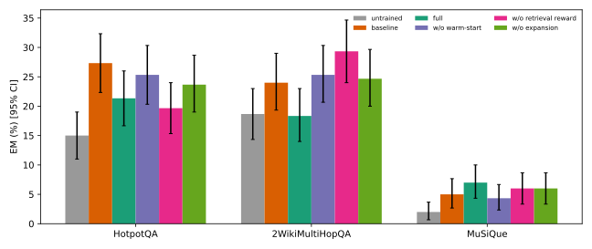
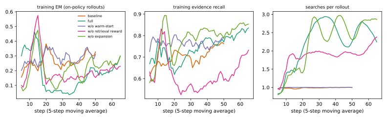

# Can David Beat Goliath? On Multi-Hop Reasoning with Resource-Constrained Agents

- 著者: Hojae Han, Heeyun Jung, Jongyoon Kim, Seung-won Hwang (ETRI / HKU / ソウル大学)
- 年: 2026 (ICML 2026、arXiv:2601.21699)
- タグ: 強化学習, GRPO, 検索エージェント, multi-hop QA, 小さな言語モデル, 低予算

## 一言でいうと

検索を呼びながら多段の質問に答えるエージェントを強化学習(RL)で鍛える研究は、大きなバッチと多くの rollout を前提にしてきました。この論文は、バッチ 24 問 × 最大 6 本の rollout という低予算(VRAM 24GB のコンシューマ向け GPU 4 枚)でも、1.5B 以下のモデルが多段の推論を学べると主張します。そのために GRPO に 3 つの部品を足した DAVID-GRPO を提案します。(i) 4 件だけの専門家の軌跡で初期化する few-shot warm-start、(ii) 検索で集めた文書が正解の根拠文書をどれだけ含むかを報酬にする grounded retrieval reward、(iii) 惜しい軌跡を、検索に成功した時点から再サンプリングする grounded expansion です。

この README は、3 部品を **VRAM 16GB・bf16 なしの GPU に収まる設定**(Qwen2.5-0.5B-Instruct への LoRA、fp16、プロセスのメモリ上限 15GB)で一から実装し、学習と評価を一通り回した記録です。結論を先に書くと、**学習そのものは 16GB に十分収まりました**(全フェーズのピークは下の表のとおり、上限の 15GB を大きく下回ります)。一方で、**この規模では DAVID-GRPO の EM 上の優位は再現できていません**。結果の詳細は「縮小再現の設定と結果」に、信頼区間つきで書きました。

## 背景・課題

- RL で鍛えた検索エージェント (Search-R1、Tree-GRPO など)は、大きなモデルと大量の rollout を使う「高コスト・高精度」の領域で成果を出してきました。バッチと rollout を減らすと、小さなモデルは「低コスト・低精度」に落ちます。
- 論文はその原因を 3 つに整理します。(1) Cold-Start: 初期方策が有効な検索クエリを作れず、報酬が得られません。(2) Sparse Rewards: 軌跡の最後の正誤だけでは、途中の検索の良し悪しを評価できません。(3) Limited Exploration: rollout が少ないと、報酬を得る軌跡が見つかりません。
- 着想はゼロショット検索の 3 つの定石です。疑似適合性フィードバック(初期の検索を疑似的な正例で導く)、適合性判定(人手の判定を密な信号にする)、適応的検索(検索済みの結果から探索を広げる)を、それぞれ (i)(ii)(iii) に対応させています。

## 提案手法

質問 x、正解 a\*、正解の根拠文書の集合 D\* を持つ学習例を使い、方策 π が「思考 → 検索 → 結果 → … → 答え」を出す過程を MDP として扱います。GRPO は、1 問につき G 本の軌跡を方策から引き、報酬をグループ内で標準化した値を利点にします(式 1)。

**(i) few-shot warm-start (3.2 節、式 2)**

専門家(大きなモデル、または人手)の軌跡 τ\* を k = 4 件だけ用意します。1 問について、専門家の軌跡 1 本と on-policy の G − 1 本で 1 グループを作り、同じ GRPO の目的で更新します。専門家の軌跡には、模倣を促す利点 Â(τ\*) を割り当てます。重要度比 ρ\* は 1 とします(付録 D.2)。SFT だけ、または off-policy RL だけより、混合のほうが良いというのが論文の主張です(図 5)。

**(ii) grounded retrieval reward (3.3 節、式 3〜5)**

軌跡の全ての検索で得た文書の和集合 D_union を作り、D\* のうちそこに含まれる割合を r_g とします。総報酬は R = λ r_g + (1 − λ) r_o です (r_o は最終の答えの正誤、λ = 0.5)。D\* は順序のない集合で、検索の手順との対応が分からないので、ステップごとではなく軌跡全体で測ります。

**(iii) grounded expansion (3.4 節、式 6〜7)**

グループの最良の軌跡 τ_M の報酬が 1 未満なら、「必要な情報をまだ取り切れていない惜しい例」とみなします。τ_M で最後に有効な証拠が得られた検索の時点 t′ を求め、そこまでで切り詰めて、続きを l = 5 本サンプルします。最も報酬の高い続きが元の τ_M を上回れば、グループの最悪の軌跡と入れ替えます。

## 実験と結果(論文)

- 設定: 学習は HotpotQA の訓練データ 5,276 問(AutoCoA が公開した部分集合)。検索器は E5-base-v2 + FAISS(wiki-18 コーパス)。評価は HotpotQA、2WikiMultiHopQA、MuSiQue、Bamboogle、BamTwoogle、AntiLeakBench の 6 つ。指標は EM と F1。モデルは Qwen2.5 (0.5B、1.5B) と Llama-3.2-1B。
- 低予算の設定(表 9): バッチ 24、rollout は 1 問あたり最大 6 本(DAVID-GRPO は基本 5 本で、拡張が平均 1.1 本を足す)。warm-start は 4 件で 50 ステップ(バッチ 4、学習率 1e-5)、本学習は 215 ステップ(学習率 1e-6)。KL 係数 1e-3、clip 0.2、温度 0.6、最大検索 5 回。
- 主な結果(Qwen2.5-1.5B、表 2。EM):

| 手法 | HotpotQA | 2Wiki | MuSiQue | Bamboogle | BamTwoogle | AntiLeak-m |
|---|---|---|---|---|---|---|
| Tree-GRPO(低予算) | 12.9 | 20.5 | 2.1 | 12.0 | 5.0 | 11.7 |
| Search-R1-v0.3(検索報酬つき) | 19.0 | 21.3 | 3.6 | 8.0 | 3.0 | 16.7 |
| DAVID-GRPO | 24.8 | 27.2 | 7.1 | 14.4 | 22.0 | 36.3 |

- アブレーション (表 4、1.5B の EM): HotpotQA で DAVID-GRPO 24.8、expansion なし 23.3、検索報酬もなし 20.8。2Wiki では 27.2、24.4、22.0。MuSiQue では 7.1、5.8、4.5。
- warm-start の比較(図 5): cold start は全ベンチで EM 0.0。混合(off- & on-policy)が、SFT のみ、off-policy のみを上回ります。
- 分析: 検索した文書に橋渡し文書が 1 つでも入っていた割合 (表 3、HotpotQA)は、DAVID-GRPO が 59.1%、StepSearch が 50.6%。grounded expansion の発動率は、学習の初期に約 25%で、その後減ります (付録 A)。

## 実装メモ

- `src/david_core.py`: 軌跡の解析(`<think>` / `<search>` / `<information>` / `<answer>`)、正解一致、grounded retrieval reward、グループ内の利点、warm-start の混合グループの利点、grounded expansion の判定(最良・最悪の選択、切り詰める点 t′、置き換えの条件)、専門家の軌跡の組み立て。標準ライブラリだけで動きます。
- `src/david_stats.py`: ブートストラップ区間と、対応ありの差(numpy)。
- `tests/`: pytest。GPU なしで動きます。
- `david_mini/data.py`: 学習・評価の質問とコーパスの作成。`retriever.py`: E5-base-v2 の密検索。`rollout.py`: 検索を挟む複数ターンの生成。`train.py`: GRPO の学習ループ(3 部品をフラグで切り替え)。`evaluate.py`: 評価。`analyze.py`: 表と図。`warmstart.py`: 専門家の軌跡 4 件。`run_all.sh`、`watchdog.sh`: 学習を並列に走らせ、落ちたものを再開する。
- 依存は PyTorch、transformers、peft だけです。TRL や verl は使っていません。

### 論文との違い

| 論文 | この実装 | 影響の見込み |
|---|---|---|
| Qwen2.5 の base、全パラメータの学習 | Qwen2.5-0.5B-Instruct に LoRA (r = 16、全ての線形層)。fp16 の土台と fp32 の LoRA、GradScaler。bf16 は使わない | 学習の自由度が小さい。instruct は、初期から形式にある程度従う |
| 検索器 E5-base-v2 + FAISS、wiki-18 | E5-base-v2 + GPU の行列積。検索対象は、学習と評価の質問の候補段落の和集合 (28,696 段落)。上位 3 件、各 50 語まで | コーパスがはるかに小さく、検索が易しい。**絶対値は論文と比べられません** |
| プロンプトは `<begin search>…</end search>`、`\boxed{}` | `<search>…</search>`、`<information>`、`<answer>`(Search-R1 系の形式)。最大検索 3 回 | 形式を簡単にした |
| 学習データ 5,276 問、本学習 215 ステップ、バッチ 24 | HotpotQA の train (distractor) から 2,000 問を抽出し、うち 50 ステップ × 24 問 = 1,200 問を使う。バッチは 24 | 学習量が約 1/4 |
| warm-start 50 ステップ。専門家は 32B の蒸留モデルが作った軌跡から 4 件を選ぶ | 15 ステップ。専門家の軌跡は、学習用の 4 問について、思考と検索クエリを人手で書き、検索結果は実際の検索器の出力を差し込む | 専門家の質が違う |
| 学習率 1e-5(warm)、1e-6(本学習) | LoRA 向けに 2e-4、1e-4 | LoRA では桁が違う |
| 温度 0.6、KL 係数 1e-3 | 温度 0.8。KL 罰則は省略。1 回の rollout につき更新 1 回 (ρ = 1、clip は働かない) | 方策が動きすぎる可能性 |
| 専門家の利点 Â(τ\*) の値は記載なし | 専門家を含むグループの標準化の値と 1.0 の大きいほう | 論文の値ではない |
| rollout は DAVID-GRPO が 5 本、基準は 6 本 | 拡張ありの run は 5 本、拡張なしの run は 6 本 | 論文と同じ |
| 評価は 6 ベンチ | HotpotQA、2Wiki、MuSiQue の dev から各 300 問。貪欲、最大検索 3 回 | Bamboogle などは扱わない |

## 縮小再現の設定と結果 (`david_mini/`)

### 設定

- モデル: Qwen2.5-0.5B-Instruct に LoRA (r = 16、α = 32、q/k/v/o/gate/up/down、学習するパラメータは 8.8M)。土台は fp16、LoRA は fp32、勾配のスケーリングあり。bf16 は使いません。勾配チェックポイントを有効にし、更新はマイクロバッチ 4 本ずつです。
- データ: 学習は HotpotQA の train (distractor) から seed 0 で抽出した 2,000 問(支持文書の title が D\*)。評価は、HotpotQA (validation)、2WikiMultiHopQA (validation)、MuSiQue (answerable、validation) から、各 300 問を seed 0 で抽出しました。評価の質問は学習に使っていません。取得元は Hugging Face の hotpotqa/hotpot_qa、framolfese/2WikiMultihopQA、bdsaglam/musique です。
- コーパス: 学習 2,000 問と評価 900 問の候補段落(支持 + distractor)の和集合で、**28,696 段落**です。3 つのデータで共通の 1 つの索引を使います。検索は E5-base-v2 の密検索で、1 回の検索で上位 3 段落(各 50 語まで)を返します。段落の同一性は (title, 本文) です。根拠文書の判定は title で行います。
- エージェント: 1 ターンの生成は最大 160 トークン、検索は最大 3 回、文脈は最大 2,048 トークンです。検索回数の上限を超えて検索しようとした軌跡や、形式が壊れた軌跡は、答えなしで終わります(outcome 報酬は 0)。
- 構成(学習は seed 0 で 1 回ずつ。baseline と full だけ、seed 1 でもう 1 回):

| 名前 | warm-start | 検索報酬 λ | grounded expansion | rollout / 問 |
|---|---|---|---|---|
| baseline | なし | 0(outcome のみ) | なし | 6 |
| full (DAVID-GRPO) | 15 ステップ | 0.5 | あり (l = 5) | 5 (+拡張) |
| warm-start なし | なし | 0.5 | あり | 5 (+拡張) |
| 検索報酬なし | 15 ステップ | 0 | あり | 5 (+拡張) |
| 拡張なし | 15 ステップ | 0.5 | なし | 6 |

  本学習は全て、バッチ 24 問 × 50 ステップです。warm-start のある構成は、その前に 15 ステップ(4 問 × 専門家 1 本 + on-policy 4 本)を行います。学習率は warm-start が 2e-4、本学習が 1e-4。温度は 0.8。評価は貪欲で、300 問ずつです。
- 指標: EM(正規化した文字列の完全一致)。質問ごとの 0/1 を保存し、平均の 95% ブートストラップ区間(5,000 回の再抽出)と、同じ質問での差の区間を出します。区間が 0 をまたぐ差は「差なし」として扱います。
- 比較: 同じ形式のプロンプトで、学習していない同じモデル(「未学習」)も評価しています。
- 実行(VM 上): `python david_mini/data.py`、`bash david_mini/run_all.sh`(5 つの学習と未学習の評価を並列に起動)。落ちた学習は `watchdog.sh` が再開します。`python david_mini/analyze.py` が `docs/tables.md`、`docs/em.svg`、`docs/curves.svg` を作ります。テストは `python -m pytest`(36 件が通ります)。
- 規模: 全ての学習で、1 回の rollout につき更新は 1 回、50 ステップで学習に使った質問は 1,200 問です。

### 結果

**EM(各 300 問、平均 [95% ブートストラップ区間]、単位 %。seed 0)**

| 構成 | HotpotQA | 2WikiMultiHopQA | MuSiQue | 3 データの平均 |
|---|---|---|---|---|
| 未学習(同じ形式のプロンプトのみ) | 15.0 [11.0, 19.0] | 18.7 [14.3, 23.0] | 2.0 [0.7, 3.7] | 11.9 [9.8, 14.0] |
| baseline(outcome のみの GRPO、cold start) | 27.3 [22.3, 32.3] | 24.0 [19.3, 29.0] | 5.0 [2.7, 7.7] | 18.8 [16.3, 21.3] |
| DAVID-GRPO(3 部品すべて) | 21.3 [16.7, 26.0] | 18.3 [14.0, 23.0] | 7.0 [4.3, 10.0] | 15.6 [13.2, 18.0] |
| warm-start なし | 25.3 [20.3, 30.3] | 25.3 [20.7, 30.3] | 4.3 [2.3, 6.7] | 18.3 [15.9, 20.9] |
| grounded retrieval reward なし (λ=0) | 19.7 [15.3, 24.0] | 29.3 [24.0, 34.7] | 6.0 [3.3, 8.7] | 18.3 [15.9, 20.9] |
| grounded expansion なし | 23.7 [19.0, 28.7] | 24.7 [20.0, 29.7] | 6.0 [3.3, 8.7] | 18.1 [15.7, 20.6] |

**baseline との差(同じ質問での対応あり、% ポイント。\* は区間が 0 をまたがない)**

| 構成 | HotpotQA | 2WikiMultiHopQA | MuSiQue | 3 データをまとめた差 |
|---|---|---|---|---|
| 未学習(同じ形式のプロンプトのみ) | -12.3 [-17.3, -7.3]* | -5.3 [-10.3, -0.3]* | -3.0 [-5.7, -0.7]* | -6.9 [-9.4, -4.4]* |
| DAVID-GRPO(3 部品すべて) | -6.0 [-12.0, +0.0] | -5.7 [-12.3, +0.7] | +2.0 [-1.3, +5.3] | -3.2 [-6.3, -0.1]* |
| warm-start なし | -2.0 [-5.7, +1.7] | +1.3 [-2.7, +5.7] | -0.7 [-3.0, +1.7] | -0.4 [-2.4, +1.6] |
| grounded retrieval reward なし (λ=0) | -7.7 [-13.0, -2.0]* | +5.3 [-1.7, +12.0] | +1.0 [-2.3, +4.3] | -0.4 [-3.6, +2.6] |
| grounded expansion なし | -3.7 [-8.7, +1.3] | +0.7 [-4.7, +6.0] | +1.0 [-2.3, +4.3] | -0.7 [-3.3, +1.9] |

**full との差(各構成 − full)**

| 構成 | HotpotQA | 2WikiMultiHopQA | MuSiQue | 3 データをまとめた差 |
|---|---|---|---|---|
| 未学習(同じ形式のプロンプトのみ) | -6.3 [-12.3, -0.7]* | +0.3 [-6.0, +6.7] | -5.0 [-8.0, -2.0]* | -3.7 [-6.8, -0.7]* |
| baseline(outcome のみの GRPO、cold start) | +6.0 [+0.0, +12.0] | +5.7 [-0.7, +12.3] | -2.0 [-5.3, +1.3] | +3.2 [+0.1, +6.3]* |
| warm-start なし | +4.0 [-1.7, +9.7] | +7.0 [+0.7, +13.3]* | -2.7 [-5.7, +0.7] | +2.8 [-0.2, +5.7] |
| grounded retrieval reward なし (λ=0) | -1.7 [-6.7, +3.3] | +11.0 [+5.7, +16.3]* | -1.0 [-4.3, +2.3] | +2.8 [+0.1, +5.6]* |
| grounded expansion なし | +2.3 [-3.7, +8.3] | +6.3 [+1.0, +11.7]* | -1.0 [-4.7, +2.7] | +2.6 [-0.4, +5.6] |

**seed による違い**

| 構成 | HotpotQA | 2WikiMultiHopQA | MuSiQue | 3 データの平均 |
|---|---|---|---|---|
| baseline_s1 | 22.7 [18.0, 27.3] | 17.0 [12.7, 21.3] | 3.7 [1.7, 6.0] | 14.4 [12.2, 16.8] |
| full_s1 | 24.7 [20.0, 29.7] | 27.0 [22.0, 32.0] | 7.0 [4.0, 10.0] | 19.6 [17.0, 22.1] |

**full − baseline(同じ seed どうしの対応あり差、% ポイント。* は区間が 0 をまたがない)**

| seed | HotpotQA | 2WikiMultiHopQA | MuSiQue | 3 データをまとめた差 |
|---|---|---|---|---|
| 0 | -6.0 [-12.0, +0.0] | -5.7 [-12.3, +0.7] | +2.0 [-1.3, +5.3] | -3.2 [-6.3, -0.1]* |
| 1 | +2.0 [-3.0, +7.0] | +10.0 [+4.7, +15.7]* | +3.3 [+0.0, +6.7] | +5.1 [+2.4, +7.9]* |

| 構成 | データ | 検索回数(平均) | 答えを出した割合 % | 証拠の再現率(平均)% |
|---|---|---|---|---|
| baseline_s1 | HotpotQA | 1.00 | 100.0 | 72.5 |
| baseline_s1 | 2WikiMultiHopQA | 1.00 | 100.0 | 63.0 |
| baseline_s1 | MuSiQue | 1.00 | 100.0 | 43.8 |
| full_s1 | HotpotQA | 2.89 | 99.7 | 86.0 |
| full_s1 | 2WikiMultiHopQA | 2.73 | 99.7 | 82.7 |
| full_s1 | MuSiQue | 2.98 | 91.0 | 62.9 |

**行動と証拠の再現率(seed 0、評価 300 問ずつ)**

| 構成 | データ | 検索回数(平均) | 答えを出した割合 % | 証拠の再現率(平均)% | 証拠が全部そろった割合 % |
|---|---|---|---|---|---|
| untrained | HotpotQA | 1.00 | 92.7 | 67.2 | 43.0 |
| untrained | 2WikiMultiHopQA | 1.01 | 96.7 | 57.2 | 22.7 |
| untrained | MuSiQue | 0.99 | 94.3 | 39.2 | 6.7 |
| baseline | HotpotQA | 1.00 | 99.7 | 75.7 | 54.7 |
| baseline | 2WikiMultiHopQA | 1.00 | 100.0 | 64.1 | 28.7 |
| baseline | MuSiQue | 1.00 | 100.0 | 44.9 | 10.7 |
| full | HotpotQA | 2.01 | 99.0 | 81.7 | 67.0 |
| full | 2WikiMultiHopQA | 1.98 | 99.3 | 76.2 | 53.0 |
| full | MuSiQue | 2.06 | 99.3 | 55.9 | 23.7 |
| no_warm | HotpotQA | 1.00 | 100.0 | 77.2 | 57.0 |
| no_warm | 2WikiMultiHopQA | 1.00 | 100.0 | 64.9 | 30.0 |
| no_warm | MuSiQue | 1.00 | 100.0 | 41.5 | 10.0 |
| no_reward | HotpotQA | 2.31 | 95.0 | 77.5 | 57.7 |
| no_reward | 2WikiMultiHopQA | 2.17 | 98.7 | 73.2 | 46.7 |
| no_reward | MuSiQue | 2.39 | 93.3 | 54.3 | 22.7 |
| no_expansion | HotpotQA | 2.85 | 94.0 | 85.7 | 73.0 |
| no_expansion | 2WikiMultiHopQA | 2.88 | 97.7 | 84.9 | 64.3 |
| no_expansion | MuSiQue | 2.84 | 90.3 | 52.9 | 24.7 |

学習中の on-policy の rollout の EM は、5 ステップの移動平均です(seed 0。λ = 0 の run も EM は outcome)。warm-start のある構成は、最初の 15 ステップを含みません。

### 論文の主張との対応

| 論文の主張 | この縮小再現 | 判定 |
|---|---|---|
| DAVID-GRPO は、低予算の基準手法より EM が高い (表 2) | outcome のみの GRPO(baseline)との EM の差は、3 データをまとめて seed 0 で −3.2 [−6.3, −0.1]、seed 1 で +5.1 [+2.4, +7.9]。符号が seed で逆。2 つの seed の平均は、baseline 16.6、full 17.6 | 再現せず(seed の違いが差より大きい) |
| cold start では報酬が得られず、EM は 0 に崩れる (図 5) | baseline は cold start で、未学習の 11.9 から 18.8 に上がった(差 +6.9 [+4.4, +9.4])。ただし instruct モデルで、最初から形式にある程度従う | 再現せず(設定が違う) |
| few-shot warm-start が効く (図 5) | warm-start なしのほうが、3 データで +2.8 [−0.2, +5.7] 高い方向だが、区間が 0 をまたぐ。ただし挙動は大きく変わる(下の行) | 差なし |
| grounded retrieval reward が効く (表 4、表 5) | 検索報酬なしのほうが、3 データをまとめて +2.8 [+0.1, +5.6] 高い(逆向き)。証拠の再現率は、報酬ありの 3 構成のうち full と拡張なしで高めの傾向 (HotpotQA の再現率 平均 81.7 / 85.7 対 検索報酬なし 77.5。区間は出していない) | 再現せず(EM)。再現率は部分的 |
| grounded expansion が効く (表 4) | full と拡張なしの差は、3 データで −2.6 [−5.6, +0.4](拡張なしのほうが高い方向)。拡張が採用された割合は 618 回中 122 回(19.7%) | 差なし |
| 検索を 2〜3 回行う多段の挙動を学ぶ (図 3b、図 4b) | 学習後の検索回数(平均)は、baseline が 1.0。full は seed 0 で約 2.0、seed 1 で約 2.7〜3.0。証拠が全部そろった割合も baseline より高い(HotpotQA で 54.7% → 67.0%、seed 0) | 再現(挙動のみ。EM の改善とは結びつかなかった) |
| 拡張の発動は、学習の初期に多く、後で減る (付録 A) | full で、近い失敗のあるグループの割合は、本学習の最初の 10 ステップで 73%、最後の 10 ステップで 30%。値は論文(初期に約 25%)と違うが、減る向きは同じ | 部分的 |

### 分かったこと

- **この規模では、DAVID-GRPO の EM 上の優位は再現できませんでした。** 3 データの平均 EM は、seed 0 で baseline 18.8 に対して full 15.6、seed 1 で baseline 14.4 に対して full 19.6 です。同じ構成でも seed が違うと、平均が 4〜5 ポイント動き、構成間の差より大きいことがあります。単一 seed の比較(アブレーションの全部)から構成の優劣を言うのは、この設定ではできません。
- **挙動は seed をまたいで安定して変わりました。** baseline は、検索を 1 回だけ行って答える方策に収束しました(検索回数 1.00、答えを出す割合 100%)。warm-start と検索報酬を足すと、2〜3 回検索し、証拠が全部そろう割合が上がります。baseline の 3 データの再現率(平均)は 75.7 / 64.1 / 44.9 %、full は 81.7 / 76.2 / 55.9 % (seed 0)。ただし、検索が増えても EM は増えませんでした。
- **探索を増やした方策は、検索の上限に当たって答えを出せなくなります。** 拡張なしの構成は、検索回数が 2.85 回に上がり、答えを出す割合が 94.0 / 97.7 / 90.3 % に下がりました。full の本学習の最初の 10 ステップでは、答えを出す割合が 35% でした(最後の 10 ステップで 87%)。論文は最大検索 5 回で、この実装は 3 回です。上限の違いが影響している可能性があります。
- **λ = 0 では、grounded expansion は実質働きません。** outcome のみの報酬は 0/1 で、最良の軌跡が 1 未満なら全員 0 になり、最良と最悪が区別できないため、発動する条件(最良 ≠ 最悪)を満たしません。検索報酬なしの run で、拡張の試行は 0 回でした。論文の表 4 の最終行(拡張も検索報酬もなし)に当たる比較は、この意味で報酬と拡張を分けられません。
- 検索器とコーパスが小さい(28,696 段落)ので、1 回の検索で十分な質問が多く、多段の検索が EM を伸ばす余地が小さいと考えられます。未学習のモデルでも、1 回の検索で HotpotQA の証拠の再現率が 67.2% あります。
- 拡張のコスト: full の seed 0 で、拡張のために追加した rollout は 1 ステップあたり平均 61.8 本(基本は 120 本)でした。論文は、平均 1.1 本 / 問(基本 5 本の約 22%)と書いています。この実装は、近い失敗のあるグループが多く(序盤で 73%)、l = 5 本を全グループに足すため、約 1.5 倍の rollout になります。

### この実装がカバーしない範囲

- 論文の 1.5B のモデルと、base の Qwen。ここで試したのは 0.5B の instruct だけです(1.5B が 16GB に収まるかは、確かめていません)。
- Wikipedia 全体の検索。コーパスが小さいので、絶対値は論文と比べられません。
- Bamboogle、BamTwoogle、AntiLeakBench。
- Tree-GRPO、StepSearch、Search-R1-v0.3 との比較。比べたのは、outcome のみの GRPO と、3 部品の ON/OFF です。
- KL 罰則と、1 回の rollout に対する複数回の更新(ρ ≠ 1 の clip)。
- seed の数は、baseline と full で 2、他の構成は 1 です。アブレーションは単一 seed の点推定として読む必要があります。
- 専門家の軌跡は人手で書いた 4 件です。論文の 32B の蒸留モデルによる軌跡ではありません。選び方(どの 4 問か)の影響は調べていません。
- 学習率、温度、検索回数の上限などのハイパーパラメータの探索は行っていません。

## 16GB の GPU で動くことの確認

学習と評価は、Colab の高性能 GPU(VRAM 40GB)で動かしましたが、`torch.cuda.set_per_process_memory_fraction` でプロセスのメモリを **15GB** に制限しました。VRAM 16GB のカードで使える量の目安です。全ての学習と評価は、この上限のもとで、メモリ不足なしに最後まで走りました(途中で落ちたものは、同じ GPU を 6 プロセスで共有したことによる、物理メモリの不足が原因です。後述)。

**フェーズごとのピーク(`torch.cuda.max_memory_allocated`、GB)**

| 構成 | ステップ数 | 1 ステップの時間(秒、平均) | 生成のピーク(GB) | 学習のピーク(GB) | 全フェーズのピーク(GB) | 生成トークン/秒(平均) | 拡張の試行/採用(合計) |
|---|---|---|---|---|---|---|---|
| baseline | 50 | 35.8 | 5.38 | 2.44 | 5.381 | 206 | 0/0 |
| full | 65 | 87.7 | 8.59 | 4.51 | 8.591 | 155 | 618/122 |
| no_warm | 50 | 31.1 | 5.32 | 2.73 | 5.316 | 182 | 96/6 |
| no_reward | 65 | 62.5 | 7.55 | 3.79 | 7.552 | 210 | 0/0 |
| no_expansion | 65 | 67.2 | 10.27 | 4.01 | 10.265 | 147 | 0/0 |

- 全フェーズのピークは、最大で 10.27 GB (拡張なしの run の rollout)で、上限 15GB の内側です。1 回の更新(逆伝播と最適化)のピークは、最大で 4.51 GB でした。rollout のピークが大きいのは、1 回に生成する本数(拡張を含めると 1 ステップで最大数百本)と、文脈の KV キャッシュによります。
- 制限した点: モデルは 0.5B + LoRA (学習するのは 8.8M)。fp16 のみ(bf16 なし)。勾配チェックポイント。マイクロバッチ 4。1 ターンの生成は 160 トークン、文脈は 2,048 トークン以内。AdamW の状態は LoRA の分だけ。
- 速度(Colab の高性能 GPU での実測。VRAM 16GB の GPU では遅くなります。**測っていません**):

| 条件 | 1 ステップの時間(本学習、平均) | 生成トークン / 秒 |
|---|---|---|
| 試運転(単独で実行、バッチ 16 問 × 5 本 + 拡張、10 ステップ) | 45.8 秒(生成 41.1、更新 4.6) | 84 |
| baseline、seed 1(2 プロセスを同時に実行、バッチ 24 問 × 6 本) | 34.7 秒 | 212 |
| full、seed 1(2 プロセスを同時に実行、バッチ 24 問 × 5 本 + 拡張) | 66.2 秒(生成 58.5、更新 7.7) | 175 |
| full、seed 0(6 プロセスを同時に実行) | 105.7 秒 | 181 |

  生成トークン / 秒は、モデルが生成したトークンだけを数え、rollout の時間(検索、プロンプトの処理を含む)で割った値です。並列に走らせると 1 プロセスあたりの速度は落ちるので、単独の値とは比べられません。生成は Hugging Face の `generate` を 1 ターンずつ呼ぶ実装で、速くありません。VRAM 16GB・bf16 なしの GPU では、演算が遅くなる分、1 ステップの時間は長くなります(何倍かは測っていません)。この規模(65 ステップ)は、seed 1 の full で約 1.1 時間でした。
- 注意: 40GB のカードに 6 プロセスを同時に載せた実行では、物理メモリが足りず、2 つの学習が途中で落ちました(各プロセスの上限ではなく、合計の不足です)。チェックポイントから再開して完了しています。再開した run (検索報酬なし、拡張なし)の記録には、落ちる前に書いた数ステップが重複しているため、集計では、ステップごとに後の記録を使っています。

## 所感・疑問点

- 部品の効果を見るには、seed を増やす必要があります。この実装では、1 回の学習が 1 時間前後かかるので、アブレーションの全部を複数の seed で回すのは、予算の面で難しかったです。
- 検索の挙動が変わったのに EM が上がらなかったのは、コーパスが小さく 1 回の検索で足りる質問が多いことと、検索回数の上限(3 回)が小さいことの影響が考えられます。論文の設定(wiki-18 全体、上限 5 回)で、同じ向きの結果になるかは、この実験からは言えません。
- warm-start 直後の方策は、探索しすぎて答えを出せなくなる(答えを出す割合 35%)ので、warm-start の例の「検索の回数」が方策に強く効きます。4 件の選び方が結果に効く可能性があります。

## 費用と時間

- Colab の計算ユニット: 開始時 231.54、終了時 210.71 で、**使用は 20.83 ユニット**(上限 60、計画 45)。高性能 GPU の使用率は 1 時間あたり 6.73 ユニットでした。
- 実時間: 1 回目のセッション(試運転、5 つの学習と未学習の評価)が約 2 時間、2 回目(seed 1 の 2 つの学習)が約 1 時間 5 分です。実装とテストの時間は含みません。
- 試運転(約 10 ステップ)で、1 ステップの時間と使用率を測り、5 つの学習を 1 つの VM で並列に走らせる計画にしました。
- 全てのセッションを停止し、実行中のものがないことを確認しました。

## 参考

- https://arxiv.org/abs/2601.21699
