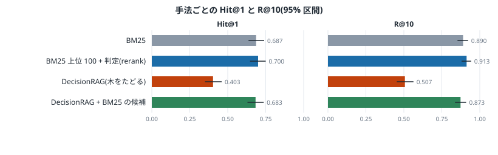

# Retriever-Free Retrieval: Navigating Documents with Decision Models

- 著者: Chao Wan, Paul Jünger, Beixi Du, Bodong Liu, Navaneetha Krishnan, Kilian Q. Weinberger (Cornell University / ASAPP)
- 年: 2026 (arXiv:2610.35868v1、2026-10-26。Preprint)
- タグ: RAG, 検索, 階層的検索, decision model, reranking, 共有文脈

## 一言でいうと

検索器(BM25 や埋め込み)を使わず、**文書の階層(トピック → 文書 → 段落)をたどって検索する** DecisionRAG の論文です。各段階で、「decision model」(文脈と質問を受けて、選択肢の確率だけを返し、トークンを生成しないモデル)が、残っている候補すべてを **1 回の順伝播で、同じ文脈の中で**採点し、有望な枝だけを残して下へ進みます。タスク固有の学習も、1 段目の検索器もなしで、dense retrieval + 8B の reranker を、MultiDoc2Dial の R@1 で 13.8 点、Natural Questions の Hit@1 で 17.4 点上回ります。検索は 1 問あたり 0.7〜1.8 秒です。

## 背景・課題

- 生成側の LLM は大きく進歩したのに、何を見せるかを決める検索側は、BM25 のような語の一致や、固定の埋め込み空間の近さのままです。検索器が見つけられなかったものは、どれほど強い生成モデルでも復元できません (capability asymmetry)。
- LLM に検索を任せる agentic な方法は、各段階で多くのトークンを生成するので、遅く、費用がかかります。
- 人は、図書館で、棚の分類から本、章へと、構造をたどって探します。コーパスの多くは、トピック、文書、節、段落という構造を持っています。

## 提案手法

**1. 判定モデル (decision model)**

Jev (TypeSafe AI) や OpenAI の decision model のように、文脈 s と質問を受けて、事前に決めた選択肢の確率を返すモデルを使います。2 つの推論モードを使います。

- **並列の二値判定**: 共有文脈 s に、問いと全候補の説明を入れ、候補ごとの質問(「この候補は関連するか」)を 1 回の順伝播で並列に評価します。確率 P(Yes | s, Q_i) は、Yes と No の間でだけ正規化され、候補の間では正規化されません(合計は 1 にならない)。候補数に制限はありません(文脈の長さまで)。
- **複数選択判定**: 候補を競合する選択肢として 1 つの質問で比べ、確率分布(合計 1)を返します。選択肢の数に上限があり(Jev は 255)、二値判定の上位にだけ使います。

**2. 共有文脈の効果**: すべての候補が同じ文脈を見るので、各確率は他の候補を見たうえで決まります。単独で見れば関連しそうな候補も、明らかに良い候補が同じ文脈にあると、P(Yes) が下がります。これで、候補の間のスコアが比べられるようになります。

**3. 階層をたどる検索 (Algorithm 1)**

1. 根の子(例: ヘルプセンターやクラスタ)の説明を共有文脈に入れ、並列に二値判定し、上位 k_1 個の枝だけ残します。
2. 残した枝の子を次の段として、同じことを繰り返します(上位 k_2 個を残す、など)。
3. 最後の段で、残った段落を二値判定し、上位 r 件を取ります。落とした枝は二度と見ません(**刈り込みは不可逆**)。
4. 任意で、二値判定の上位 m 件(m ≤ r)を、複数選択判定で並べ替え、先頭を鋭くします。

予算 k は、再現率に寄せて決めます(確率の閾値でもよい)。検索器の上位の段落を、最終の候補に足す変種 (+ dense candidates) では、刈り込みで落ちた証拠を拾えます。

**4. 階層の構築と規模**: 既存の構造(ヘルプセンター、文書、見出し)を使い、無い場合は、文書の埋め込みを再帰的に k-means でまとめて作ります(Natural Questions では、108,626 ページを 1,000 クラスタに。クラスタの説明は、Qwen3-8B が書いた 1 文の要約)。1 段が大きすぎるときは、並列の請求に分けます(1 請求 約 50 候補を超えると、共有文脈の利益は頭打ち)。釣り合った木で、各節点が b 個の子を持つなら、N 件の段落に必要な段の数は ⌈log_b N⌉ で、遅延は T(N) ≈ t_req · ⌈log_b N⌉(式 4、t_req ≈ 0.2 秒)になります。b=100 なら、10⁹ 段落でも 5 段(約 1 秒)です。

## 実験の主な結果

4 つのベンチマークで評価します: MultiDoc2Dial(4 センター・413 ページ・4,110 段落、4,201 ターン)、ConditionalQA(652 ページ・58,483 段落、285 問)、MTRAG の IBM Cloud(172 製品・8,578 ページ・72,442 段落、205 ターン)、Natural Questions の DAPR 版(1,000 クラスタ・108,626 ページ・268 万段落、500 問)。判定モデルは、学習済みの Jev 1.13 をそのまま使います。

検索の精度です (Tab. 2、%、学習なし)。

| 手法 | MD2D R@1 | MD2D R@10 | CQA Hit@1 | CQA R@10 | MTRAG R@5 | NQ Hit@1 | NQ R@10 |
|---|---|---|---|---|---|---|---|
| BM25 | 20.6 | 56.4 | 24.7 | 35.0 | 18.8 | 16.4 | 42.3 |
| Dense (Qwen3-Embedding-8B) | 27.9 | 70.9 | 47.2 | 54.0 | 26.0 | 46.2 | 87.2 |
| Dense 上位 100 + Qwen3-Reranker-8B | 33.6 | 81.1 | 64.6 | 67.2 | 32.5 | 48.0 | 89.0 |
| Dense 上位 20 + GPT-5 | 47.5 | 78.6 | 73.4 | 64.0 | 31.8 | 60.8 | 88.9 |
| **DecisionRAG (Jev)** | 47.4 | 83.6 | 69.7 | 71.9 | 34.2 | 65.4 | 86.7 |
| **+ dense candidates** | 48.5 | 84.7 | 73.4 | 76.3 | 36.6 | 66.4 | 88.9 |

- 8B の reranker つきの dense に対し、MD2D の R@1 で +13.8 点、NQ の Hit@1 で +17.4 点です。GPT-5 で rerank するのと同等以上で(NQ の Hit@1: 65.4 対 60.8)、ConditionalQA の Hit@1 だけ、GPT-5 が上です(73.4 対 69.7)。
- 生成の質 (Tab. 3、Qwen3.5-27B が上位 5 件から回答): ConditionalQA の EM は DecisionRAG 46.9 (+ dense 47.6)、Qwen3-Reranker 45.4、MTRAG の judged は 44.1 (+ dense 47.3) 対 39.4、NQ の EM は 54.2 (+ dense 54.8)。正解の段落を渡した上限は 49.4 / 60.1 / 65.3 です。
- 学習した open-weight の判定モデル (Tab. 4、MD2D): Qwen3-8B を MD2D と ConditionalQA で追加学習すると R@1 60.7、R@10 85.8 で、公表されている最良の学習済み検索 (SFRe2g、55.0 / 83.2) を 5.7 点上回ります。
- 遅延と費用 (Tab. 5): 1 問あたりの中央値で、DecisionRAG は 0.68〜1.76 秒、dense + Qwen3-Reranker は 3.3〜14.3 秒、GPT-5 の rerank は 11.8〜15.0 秒。API の費用は、DecisionRAG が 0.22〜2.33 セント、GPT-5 の rerank が 1.2〜1.9 セントです。NQ(268 万段落)でも、遅延は MTRAG と同程度 (1.73 対 1.76 秒) です。

分析です (§6)。

- **共有文脈の効果** (§6.1、6.2): MD2D で、全選択ページの段落をまとめて採点すると、ページごとに採点するより R@1 が 36.7 から 44.4 (+7.7)。NQ の 200 候補では、1 件ずつ採点して Hit@1 47.8%、1 請求 50 候補で 54.3%、それ以上はほぼ変わらず。複数選択で 200 件全部を比べると 60.6% です。
- **判定か生成か** (§6.3): 同じ階層と予算で、判定モデルを GPT-5 の生成に替えても、精度に一貫した利益はなく(GPT-5 の側から見て、ConditionalQA の Hit@1 は +4.1、NQ は −6.0)、34〜145 倍遅く、21〜25 倍高価です。
- **複数選択の効果** (§6.4): MD2D の R@1 は 50.1 から 51.3、ConditionalQA の Hit@1 は 71.9 から 76.5。追加の請求は 0.12〜0.15 秒です。
- **木をたどるか、rerank か** (§6.5): 同じ判定モデルで、dense 上位 100 件を rerank するより、木をたどるほうが、ConditionalQA の Hit@1 で +7.7、NQ で +7.0。gold を含む率は dense の上位 100 件のほうが高い(NQ 98.4% 対 94.0%)のに、含まれているときに 1 位に置く率は、木をたどるほうが高い(70.1% 対 61.9%)です。文書を読む順に、全体として見せるためと考えられています。
- **予算** (§6.6): NQ で、クラスタの 15% を残すと、全ページのタイトルを平らに採点する場合と同じ R@10 (86.2 対 84.5) で、費用は 5 分の 1 (2.3 対 12.1 セント)、遅延は 3 分の 1 (1.7 対 4.5 秒)。5% 未満では、正解のクラスタを落とし、1% で R@10 は 63.7% に下がります。MD2D で、残すページを 3 から 10 に増やすと、R@10 は 81.0 から 83.6、R@1 は 46.9 から 47.4 で、費用は 83% 増、遅延は 28% 増です。

限界として、階層の構造とノードの説明が良くないと精度が下がること、刈り込みが不可逆なので、祖先を落とすと段落を取りこぼすこと(予算の増加と、dense の併用で緩和)が挙げられています。

## 実装メモ

`src/decisionrag_core.py` に、依存のない純 Python で中核を実装しました(Algorithm 1、請求の分割、複数選択、検索器の候補の追加、指標、式 4)。判定モデルは、`Judge`(`binary` と `choice` の 2 つの関数)のインターフェースとして扱い、中身から切り離しています。

| 関数・クラス | 対応する主張 |
|---|---|
| `navigate` / `NavConfig` | Algorithm 1(段ごとの二値判定、上位 k_l の枝、不可逆な刈り込み、`weight_by_parent`、`m`、`promote_only`、追加の候補) |
| `split_requests` / `judge_pooled` | 大きな段を、並列の請求に分ける(§3.4、§6.2) |
| `flat_rerank` | 検索器の候補を、同じ判定モデルで 1 段だけ採点する比較(Tab. 8) |
| `levels_needed` / `latency_estimate` | 式 4: 遅延は、段の数に比例し、コーパスの大きさには比例しない |

判定モデルは `decisionrag_mini/judge.py` にあります。論文の付録 G に沿って、Qwen3-Base の言語モデルの head を、採点用の head に替えます。

- 文脈のあとに、候補ごとの質問(選択肢は "no" と "yes")を並べます。質問は、文脈の直後の位置から始まり(位置 id が同じ)、互いには注意せず、文脈は質問を見ません。1 回の順伝播で、全候補の確率が、共有文脈だけで決まります。
- head は、質問の末尾と各選択肢の末尾の隠れ状態を、共通の空間に射影し、コサイン類似度に、学習する逆温度(上限 100)を掛けて、選択肢の上で softmax を取ります。学習は交差エントロピーです。複数選択は、候補の番号を選択肢にします。
- 論文が明記していない点は、次のように決めました(仮定)。選択肢のトークンは、自分の質問と文脈を見ます。選択肢どうしは、既定では見えません(`option_link` で、論文の一部の checkpoint にある「選択肢の末尾どうしの注意」を有効にできます)。選択肢の位置 id は、質問の直後から始まり、対称です。

```bash
python -m venv .venv && source .venv/bin/activate
pip install -r requirements.txt
python -m pytest -q tests          # 28 件(判定モデルのテストは、小さなランダムの Qwen3 で CPU 上で動く)
```

テストが確かめていることは、次のとおりです。

- 刈り込みが不可逆で、落とした枝の下は一度も採点されない。予算を増やすと残る。
- 段の数が、木の深さに等しい(複数選択で +1)。請求の分割で、順序と個数が保たれる。
- 複数選択が、上位 m 件だけを並べ替える。式 4 が、10⁹ 段落で 5 段(1.0 秒)になる。
- **ある候補の質問を書き換えても、他の候補の確率は変わらない**(共有文脈だけで決まる)。文脈は質問を見ない。選択肢の確率の合計が 1 になる。
- 小さなモデルで、学習ループが動き、損失が下がり、正解の候補の P(Yes) が最大になる。
- 学習例の生成が、設定した確率(正解のクラスタを含む率 0.85 など)に従い、dev の問いを使わない。

## 縮小再現の設計

**状況(2026-11-12)**: 実装とテスト(上記)に加え、判定モデルの学習と、全実験の評価まで実行しました。結果は、次の節に書きます。

- 動作確認(smoke): 学習(LoRA、bf16)と、実験の通し実行が GPU で通ることを確認しました。
- 判定モデルの学習(Qwen3-1.7B-Base、LoRA r=64): 学習例 16,000 件(問い 4,000 件 × 4 段)、2,000 ステップ、損失は 0.83 から 0.13 に下がりました。約 3.2 時間(Modal の VRAM 80GB の GPU)。長すぎて除外した例が 951 件(6%)あります(12,000 トークンの上限。段落段の長い例)。
- 評価(300 問、SQuAD の dev): 約 5 時間。結果は `decisionrag_mini/results/judge.json`、図と表は `docs/` にあります。

論文の事前学習済み判定モデル (Jev) は、手元で使えないので、論文の §5.3 に沿って、**open-weight の判定モデルを、自前で学習する**形にします。

| 項目 | 論文 | この再現 |
|---|---|---|
| 判定モデル | Jev 1.13(学習なし)。§5.3 は Qwen3-8B などを追加学習 | Qwen3-1.7B-Base + 採点用の head。LoRA(r=64、α=128)で、SQuAD の train の問いだけから学習 |
| コーパス | MD2D、ConditionalQA、MTRAG、NQ(最大 268 万段落) | SQuAD v1.1(train と dev の記事を合わせて 490 記事、約 2 万段落)。木は、クラスタ(20)→ 記事 → 段落 |
| 階層 | 既存の構造、または k-means + LLM の要約 | k-means(TF-IDF、k-means++)。クラスタの説明は、中心に近い記事のタイトルを並べたもの(LLM は使わない) |
| 評価 | 各データセットのテスト | SQuAD の dev の問い(300 問)。正解は、答えを含む段落 1 件 |
| 比較 | dense、reranker、GPT-5 | BM25、BM25 上位 100 件を同じ判定モデルで並べ替え、DecisionRAG、+ BM25 の候補(dense、GPT-5 は使わない) |

学習例は、ナビゲーションの各段と同じ入力にします(推論時と合わせるため)。クラスタ段(全クラスタを並べ、正解のクラスタに yes)、ページ段(クラスタ 3 つの記事のタイトル。0.85 の確率で正解のクラスタを含む)、段落段(記事 2 つの全段落。0.9 の確率で正解の記事を含む。もう 1 つは BM25 の難しい負例)、複数選択段(正解 + BM25 の難しい負例 9 件)です。

確かめる主張と実験(`decisionrag_mini/experiments.py`)は、次のとおりです。

| 実験 | 論文の対応 | 内容 |
|---|---|---|
| `main` | Tab. 2、8 | BM25、BM25 上位 100 + 判定、DecisionRAG、+ BM25 の候補。Hit@1、R@10、nDCG@10、判定数、時間 |
| `pool_scaling` | Fig. 5 | 候補数 N(5〜200)で、1 件ずつ、全部 1 請求、複数選択、二値の上位 → 複数選択 |
| `request_size` | Fig. 6 | 200 件の池を、1 請求 m 件に分ける |
| `choice` | Tab. 7 | 複数選択の有無(m=0、5、20) |
| `budget` | Fig. 7、Tab. 9 | 残すクラスタ・記事の数と、再現率、判定数、時間 |
| `latency` | 式 4 | 1 請求の候補数と時間。式 4 の見積もりの表 |

実行は、環境(Modal、Colab、手元の GPU)に依存しません。

```bash
python decisionrag_mini/run_local.py prepare --work work                       # SQuAD から木・問い・学習例を作る(CPU)
python decisionrag_mini/run_local.py train   --work work --out work/judge      # 判定モデルの学習(GPU)
python decisionrag_mini/run_local.py eval    --work work --judge work/judge --result decisionrag_mini/results/judge.json
python decisionrag_mini/run_local.py eval    --work work --judge lexical --exps main   # GPU なしの配線確認(語彙の重なりで採点)
python decisionrag_mini/make_figure.py --results decisionrag_mini/results/judge.json --out docs

modal run decisionrag_mini/modal_app.py --stage smoke    # Modal で動かす場合(GPU は環境変数 DR_GPU で選ぶ)
```

GPU の選び方の目安です(Qwen3-1.7B-Base、LoRA、bf16。FLOPs からの見積もりで、実測ではありません)。

| GPU(例) | VRAM の目安 | 学習 1 エポック(問い 4,000 件、約 6,000 万トークン) | 全実験の評価 |
|---|---|---|---|
| VRAM 80GB の高性能 GPU | 余裕 | 約 1.5 時間 | 約 0.5 時間 |
| VRAM 48GB の GPU | 余裕 | 約 3 時間 | 約 1 時間 |
| VRAM 24GB の GPU | LoRA で足りる(12〜16GB)。候補 200 件の池は、長い文脈で約 25,000 トークン | 約 8〜9 時間 | 約 2 時間 |

全パラメータの学習(`--full`)は、約 40GB 以上が要ります。学習の件数は `--n-train-questions` で減らせます(半分にすると時間も半分)。

## 縮小再現の結果

評価は、SQuAD の dev の 300 問(正解は、答えを含む段落 1 件)で、候補を共有文脈で採点する判定モデルは、上の学習済みの 1.7B です。95% 区間は、質問を復元抽出するブートストラップです。



| 手法 | Hit@1 | R@10 | 判定数/問 | 逐次の段数 |
|---|---|---|---|---|
| BM25 | 0.687 [0.637, 0.740] | 0.890 [0.853, 0.923] | 0 | 0 |
| BM25 上位 100 + 判定(rerank) | 0.700 [0.647, 0.750] | 0.913 [0.880, 0.943] | 105 | 2 |
| DecisionRAG(木をたどる) | 0.403 [0.350, 0.460] | 0.507 [0.453, 0.563] | 213 | 4 |
| DecisionRAG + BM25 の候補 | 0.683 [0.630, 0.737] | 0.873 [0.837, 0.910] | 227 | 4 |

論文の主張との対応です。

| 論文の主張 | この再現 | 判定 |
|---|---|---|
| 候補を共有文脈で一緒に採点すると、1 件ずつより良い (+6.5〜7.7 点) | 全部 1 請求 − 1 件ずつ = 5 件: −0.007、25 件: −0.040、100 件: −0.053、200 件: **−0.080** [−0.153, −0.007](Hit@1)。共有文脈のほうが悪い | **再現できず**(逆の向き) |
| 1 請求 50 候補までは、分割しても損がない。分割しない(200 件)ほうが、1 件ずつより上がる | 候補 200 件の池を m 件ずつに分けた Hit@1 は、m=1 で 0.693、m=200 で 0.627。小さい請求ほど良い | **再現できず** |
| 複数選択は、二値判定の全部 1 請求より上がる (NQ の 200 件: 54.3% から 60.6%) | 複数選択(全候補)− 二値の全部 1 請求は、5 件: +0.040、25 件: +0.040、100 件: +0.047、200 件: **−0.033**。二値の上位 → 複数選択は、200 件で 0.673(二値の全部 1 請求は 0.613)。区間は、質問数 150 では広い | 100 件までは再現。200 件の全候補では再現せず |
| 複数選択による並べ替えで、先頭が鋭くなる (MD2D: +1.2、CQA: +4.6) | m=0: 0.390、m=5: 0.403、m=20: 0.397(木をたどる検索の Hit@1) | 差なし |
| 木をたどるほうが、検索器の候補を rerank するより良い | 木をたどる 0.403 に対し、BM25 上位 100 + 判定 0.700。差 −0.297 [−0.353, −0.240] | **再現できず**(逆の向き) |
| BM25 などの検索器を使わず、dense + 8B の reranker を上回る | BM25 単独(0.687)より、木をたどる検索は −0.283 [−0.360, −0.210] | **再現できず** |
| + 検索器の候補を足すと、刈り込みで落ちた証拠を拾える | 0.403 から 0.683 に上がるが、BM25 単独(0.687)と同じ水準(差 −0.003 [−0.070, +0.067])。BM25 の候補の効果で、判定モデルは上積みなし | 検索器の補いは働くが、判定モデルの利益なし |
| 予算を増やすと、再現率が上がる(遅延と費用は増える) | R@10 は、k2 ごとに、k1 を増やすほど単調に上がる。0.387(k1=1、k2=1、判定 104 回)から 0.663(k1=全部、k2=3、判定 663 回)まで。ただし、最大でも BM25(0.890)に届かない | 向きは同じ(再現) |
| 遅延は、段の数に比例し、コーパスの大きさには比例しない(式 4) | 式 4 の見積もりの表は、論文と同じ。実測では、1 請求の時間は、候補数に対し線形より速く増える(10 件 0.04 秒、100 件 0.65 秒、200 件 2.06 秒、300 件 3.07 秒) | 見積もりの前提(1 請求 0.2 秒)は、候補が多いと成り立たない |
| BM25 上位 100 件を判定モデルで rerank する(Jev Rerank) | BM25 より +0.013 [−0.053, +0.080](Hit@1)、R@10 は +0.023 [−0.017, +0.063]。差は誤差の範囲 | 上積みなし |

### 分かったこと(と、分かっていないこと)

- **この判定モデルは、候補を選ぶ力が弱く、検索の質は BM25 に届きません。** 木をたどる検索の再現率が、予算を最大にしても BM25 より低いのは、各段の判定が、正解の枝を残せていないためです。特に、記事のタイトルだけを見て、問いに関連する記事を選ぶ段が難しいと見ています(SQuAD の問いは、記事のタイトルを含まないことが多い)。
- **共有文脈の効果が出なかった原因は、特定できていません。** 候補の質問が互いに見えないこと自体は、小さなランダムのモデルのテストで確認しています(学習済みのモデルでの確認ではありません)。考えられる仮説は 3 つあります。(1) 判定モデルが、学習時の請求の大きさ(段落段で約 86 件)に偏っていて、5 件や 200 件の請求では、確率の校正が崩れる。(2) 学習が 1 エポックで、判定の質が足りず、他の候補を見ても利益にならない。(3) 候補が増えるほど、注意が薄まる(長い文脈で、質問の位置が遠くなる)。いずれも、検証していません。
- **論文は、強い事前学習済みの判定モデル(Jev)を使っています。** それを、1.7B の Qwen3-Base を SQuAD だけで 1 エポック学習したものに替えた条件で、共有文脈の効果が出なかった点は、「判定モデルが強くないと、共有文脈の利益は出ない」という見方と矛盾しません。ただし、判定モデルの質を変えた比較をしていないので、断定はできません。
- **この結果は、論文の主張を否定するものではありません。** 論文の主実験(Tab. 2〜8)は、別の判定モデルと、別のコーパス、別の評価で行われています。

## この実装がカバーしない範囲

- 論文の事前学習済み判定モデル (Jev、OpenAI の decision model) は使えないので、論文の主実験(Tab. 2、3、5、6、8)の数値の再現はできません。見たのは、判定モデルの性質(共有文脈、請求の大きさ、複数選択、予算)が、小さい判定モデルと、小さいコーパスでも出るか、という向きだけです(結果は上の節)。
- dense retrieval、Qwen3-Reranker、GPT-5 との比較、生成の質 (Tab. 3)、判定か生成かの比較 (Tab. 6)、MultiDoc2Dial と MTRAG の会話(notepad)、ConditionalQA は含みません。
- 判定モデルの「一般的な」学習(多肢選択・分類のデータの混合)はしません。SQuAD だけで学習するので、評価の記事の段落は、学習時に文脈として現れます(問いは現れません)。
- コーパスは約 2 万段落で、論文の 268 万段落の規模(階層が深くなる効果)は確かめられません。遅延と段の数の関係は、式 4 の見積もりの検算と、1 請求の時間の測定にとどまります。

## 所感・疑問点

- 提案の核は「判定モデルが、候補を比べられる確率を、1 回の順伝播で返す」ことで、検索側の工夫は階層と予算だけです。判定モデルの質と、階層の質が、そのまま検索の質になる設計だと読みました。
- 論文の主実験は、判定モデル(Jev)が非公開(API)で、読者は同じ数値を再現できません。open-weight の判定モデルを自前で学習できること (§5.3、付録 G) が、再現の足場になります。8B の学習で MD2D の R@1 が 60.7 に達する一方、一般学習だけの 1.7B は 20.5 (R@1) で、判定モデルの大きさと学習の効き方が大きいことがうかがえます。
- 共有文脈の効果を、候補数 50 付近で頭打ちと見る点は、分割の設計(請求のサイズ)に直接効くので、小さい判定モデルで、同じ傾向が出るかを知りたいです。
- 刈り込みが不可逆な設計で、「予算が不足するとき、どの段で落ちるか」(クラスタ、記事のどちらか)は、階層の作り方に依存します。クラスタの説明が LLM の要約である点も、結果への寄与が分かりにくいので、ここでは、中心に近い記事のタイトルの列挙で代用します。

## 参考

- 論文: Chao Wan, Paul Jünger, Beixi Du, Bodong Liu, Navaneetha Krishnan, Kilian Q. Weinberger. *Retriever-Free Retrieval: Navigating Documents with Decision Models*. arXiv:2610.35868. https://arxiv.org/abs/2610.35868
