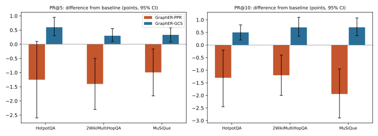
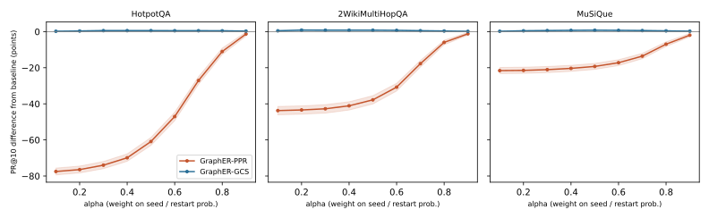

# GraphER: An Efficient Graph-Based Enrichment and Reranking Method for Retrieval-Augmented Generation

- 著者: Ruizhong Miao, Yuying Wang, Rongguang Wang, Chenyang Li, Tao Sheng, Sujith Ravi, Dan Roth (Oracle AI)
- 年: 2026 (arXiv:2603.24925)
- タグ: RAG, リランキング, グラフ, Personalized PageRank, multi-hop QA, 検索の完全性 (Perfect Recall)

## 一言でいうと

多段の質問では、必要な段落が 1 つでも欠けると答えられません。通常の検索器は、質問と段落を 1 件ずつ比べるので、「検索済みの段落と関係が深いが、質問そのものとは似ていない段落」を拾えません。GraphER は、検索器が返した上位 200 件の候補だけで、その場でグラフを作り(名前付き実体を共有する段落どうしを辺でつなぐ)、グラフ上で点数をならして並べ直します。知識グラフの索引も LLM の反復呼び出しも要りません。

この README は、LLM を使わずに SLM で小規模にこの主張を確かめた記録です。結論を先に書くと、次のとおりです。

- Graph Cohesive Smoothing (GCS) の改善は、**向きと有意性は再現できましたが、大きさは小さいままです**。PR@10 で +0.5〜+0.7 ポイントです(論文は +0.5〜+1.8)。
- PPR が悪化する点も再現できました。ただし PPR の悪化は、alpha を探索の端 (0.9) に選んでもなお出ます。alpha を下げると数十ポイント落ちます。
- GAT ランカーは、3 データセット中 2 つで GCS を上回りました。MuSiQue は差なしです。
- 辺の根拠をまれな実体に絞った変種では、GCS の改善が +3.0〜+6.5 ポイントに伸びました(論文にない追加の観察です)。

論文の実体抽出 (GPT-4o) と検索器 (8B の埋め込みモデル) を、LLM 不使用の抽出器と小さな埋め込みモデルに置き換えているので、論文の手法そのものの反証にはなりません(「論文との違い」の節)。

## 背景・課題

- 埋め込み検索や cross-encoder は、質問と段落を 1 件ずつ採点する点別のランカーです。候補どうしの関係は見ません。
- 例えば SQL 生成のためのテーブル検索では、Customers テーブルは質問との意味的な近さよりも、Orders との外部キーで必要になります。意味的な近さだけでは、これを拾えません。
- 反復する agentic な検索は、検索のたびに LLM を呼ぶので遅く、費用がかかります。知識グラフを別に持つ方法は、索引の保守が要ります。
- GraphER が狙うのは、データの組織構造(外部キー、ハイパーリンク、同じ文書の隣接チャンク、共通の実体)が手元にある場合に、追加の基盤なしで、上位 K 件の完全性を上げることです。

## 提案手法

流れは 4 段です。

1. **索引時の付加情報**: 各データ(段落、表、チャンク)に、近さを表すメタデータを付けます。構造的近接(外部キー、リンク)、概念的近接(共有する名前付き実体。論文は GPT-4o で抽出)、文脈的近接(同じ文書の隣接チャンク)の 3 種です。コーパスを 1 回走査するだけで済みます。
2. **候補検索**: ハイブリッド検索(0.7 × cosine + 0.3 × 正規化 BM25)で上位 200 件を取り、それぞれに初期点数 s を付けます。
3. **質問時のグラフ構築**: 候補を節点とします。多段 QA の辺の重みは、A_ij = (i と j が共有する固有な実体の数) / (j の固有な実体の数) です。表と隣接チャンクは、関係があれば重み 1 です。
4. **グラフ上の並べ直し**:
   - **PPR**: 通常の Personalized PageRank です。確率が辺をたどって集まるので、次数の大きい節点(ハブ)に質量が溜まります。論文はこれを「ハブへの偏り」と呼びます。
   - **GCS (Graph Cohesive Smoothing)**: 行を正規化した W を使い、p ← α s + (1 − α) W p を収束するまで繰り返し、最後に max(p, s) を返します。近傍の点数で平均をとる形なので、確率を集める形にはなりません。最後の max で、どの節点の点数も初期点数を下回りません。
   - **GAT ランカー**: GATv2 を 5 層、全結合を 2 層重ねます。入力は [GCS の点数, 質問の埋め込み, 段落の埋め込み] を連結したもので、出力が最終点数です。辺の重みは注意が学びます。

## 実験と結果(論文)

- 課題とデータ: 表検索 (Spider 1.0、Bird、Beaver)、多段 QA (HotpotQA と 2Wiki は dev から 2,000 問、MuSiQue は answerable の dev 全体)、チャンク検索 (BEIR-NQ)。
- 検索器: Llama-Embed-Nemotron-8B または Cohere-Embed-V4 に BM25 を足したハイブリッド。候補は 200 件。
- 指標: Perfect Recall (PR@K)。正解がすべて上位 K 件に入っていれば 1 です。
- alpha は 0.1〜0.9 を Bird_train で選び、他のデータでは固定します。辺の重みは調整しません。GAT は Bird_train と Spider1_train で学習します。
- 多段 QA の PR@10 (論文の表 3。Nemotron の行 / Cohere の行):

| 手法 | HotpotQA | 2Wiki | MuSiQue |
|---|---|---|---|
| baseline | 88.2 / 85.5 | 49.4 / 48.3 | 35.5 / 34.1 |
| GraphER-PPR | 84.5 / 85.8 | 49.6 / 52.8 | 27.7 / 34.6 |
| GraphER-GCS | 88.7 / 86.4 | 51.1 / 50.1 | 36.9 / 35.5 |
| GraphER-GAT | 88.9 / 87.0 | 53.0 / 50.7 | 37.4 / 36.3 |

- 主張: GCS は 18 設定すべてで基準を上回る。PPR は 18 設定中 12 で上回り、2 設定では 7% を超えて悪化する(ハブが常に上位に来るため)。GAT は 15 設定中 14 で上回る。遅延は 200 候補の並べ直しで GCS が 0.49 秒、GAT が 0.55 秒。
- 論文のコードは、本文では公開が明記されていません。この実装は論文の記述だけから書きました。

## 実装メモ

- `src/grapher_core.py`: ハイブリッド検索の点数、スパース行列による BM25、実体集合からの辺の重み (A_ij)、行の正規化、PPR、GCS。依存は numpy と scipy だけです。
- `src/grapher_metrics.py`: PR@K、Recall@K、ブートストラップ区間、対応ありの差、悪化した質問数、ハブの指標。
- `grapher_mini/`: データ作成 (`data.py`)、LLM を使わない実体抽出 (`ents.py`)、検索と候補・グラフの作成 (`pipeline.py`)、全 alpha の評価 (`run.py`、`run_all.sh`)、素の torch による GATv2 ランカー (`gat.py`)、表と図の生成 (`analyze.py`)、結果の JSON (`results/`)。
- `tests/`: pytest 33 件が通ります。辺の重みの式(非対称性)、行の正規化、GCS が seed 以上であること、辺がなければ GCS = seed、alpha = 1 で GCS = seed、GCS が線形方程式の解と一致すること、スター型グラフでの PPR のハブ偏り(ハブが関連のあるリーフを上回り、GCS では上回らない)、PR@K の端の場合(k = 0、候補不足、正解が空)などを確かめています。
- 環境: ローカルの GPU (VRAM 12GB) で埋め込みを計算し、グラフの処理は CPU です。Modal は使っていません。

### 論文との違い

| 論文 | この実装 | 影響の見込み |
|---|---|---|
| Llama-Embed-Nemotron-8B / Cohere-Embed-V4 | BAAI/bge-small-en-v1.5 (33M 級) | 基準が低くなり、候補 200 件に正解が全部入る割合も下がります(2Wiki 61.8%、MuSiQue 57.3%)。並べ直しの上限が低くなります |
| 実体抽出に GPT-4o | spaCy en_core_web_sm の固有表現。小文字化、冠詞の除去。CARDINAL、ORDINAL、QUANTITY、PERCENT、MONEY は除外 | 抽出が粗く、ありふれた実体 (american など) が多いので、候補グラフがきわめて密になります(平均次数 32〜46、候補 200 件中) |
| BM25 は未指定の実装 | 自前のスパース行列の BM25 (k1 = 1.2、b = 0.75)。質問ごとに全文書での最大値で割る | 小さい |
| alpha は Bird_train で選ぶ | HotpotQA の dev から、評価とは別の 500 問(コーパスも別に作る)で選ぶ。PR@10 が最大の値。PPR と GCS で別々に選ぶ | 評価の質問を選択に使っていません。1 つのデータで選んで他へ固定する点は論文と同じです |
| PPR の定義は未記載 | p ← α v + (1 − α) Pᵀ p。v は seed を和 1 に直したもの、P は行を正規化した遷移確率。出る辺のない節点の質量は v に戻す。α は再起動確率 | alpha の格子 0.1〜0.9 が、α と 1 − α のどちらの流儀でも覆われます |
| GAT は Bird と Spider で学習 | HotpotQA の dev から、評価とは別の 2,000 問で学習(うち 200 問を検証)。3 データセットにそのまま適用します | 学習データが違うので、論文の GAT の値とは単純に比べられません |
| 多段 QA の回答精度 (GPT-5) | 測っていません | 検索の完全性だけを見ています |
| HotpotQA 19,323 段落、2Wiki 12,601 段落、MuSiQue 21,100 段落 | 19,278、11,689、21,100 段落 | HotpotQA と 2Wiki は乱数による抽出なので、わずかに違います(MuSiQue は全問なので一致) |

## 縮小再現の設定と結果 (`grapher_mini/`)

### 設定

- データ (Hugging Face): hotpotqa/hotpot_qa (distractor)、framolfese/2WikiMultihopQA、bdsaglam/musique (answerable)。いずれも validation。HotpotQA と 2Wiki は、乱数 (seed 0) で並べた先頭 2,000 問が評価用です。HotpotQA はその次の 500 問が alpha の選択用、さらに次の 2,000 問が GAT の学習用です。2Wiki にも学習用の 1,000 問を作りましたが、GAT の学習には使っていません。MuSiQue は answerable の 2,417 問すべてを評価に使います。コーパスは、各分割の質問の候補段落(支持+ distractor)の和集合です。正解は、HotpotQA と 2Wiki が supporting_facts の title、MuSiQue が段落ごとの is_supporting です。
- 手法: baseline (ハイブリッドの順位そのまま)、GraphER-PPR、GraphER-GCS、GraphER-GAT、GraphER-MLP(GAT からメッセージパッシングを抜いた対照)。
- alpha の選択: HotpotQA の別の 500 問で、PR@10 が最大の alpha。結果は PPR が 0.9、GCS が 0.6 です。選んだ値を 3 つの評価データにそのまま使いました。評価データ上の alpha ごとの値は「感度」として示しますが、選択には使っていません。
- 辺の作り方 (実体の集合):
  - `ner`(主): 段落本文の固有表現。論文に最も近い設定です。
  - `ner+title`: `ner` に、段落の title を実体として足したもの。
  - `ner_rare`: `ner` から、コーパス内で 20 段落を超えて出る実体を外したもの。閾値 20 は 1 回だけ置いた値で、調整していません。主な結果を見たあとに追加した変種なので、探索的な位置づけです。alpha は、この変種でも HotpotQA の別の 500 問で選びなおしています(PPR 0.9、GCS 0.3)。
- 指標: PR@5、PR@10。質問ごとの値を保存し、平均の 95% ブートストラップ区間 (5,000 回の再抽出)と、基準との対応ありの差の区間を出します。区間が 0 をまたぐ差は「差なし」と書きますが、同等であることの証明ではありません。表の * は、差の区間が 0 をまたがないことを表します。
- 実行: `grapher_mini/run_all.sh` で全データの評価、`python grapher_mini/ents.py hotpot 2wiki musique` で実体抽出、`python grapher_mini/gat.py --alpha 0.6` で GAT、`python grapher_mini/analyze.py` で `docs/tables.md`、`docs/main.svg`、`docs/alpha.svg`、`grapher_mini/results/summary.json` を作ります。

### 結果

以降の数値はすべて `grapher_mini/results/*.json` から `grapher_mini/analyze.py` で計算したものです(全表は `docs/tables.md`)。単位は %(差は % ポイント)です。

**主な比較(辺の作り方 `ner`。平均 [95% ブートストラップ区間])**

| データ | 手法 | PR@5 | PR@10 | PR@10 の差(基準比) | PR@10 悪化/改善した質問数 |
|---|---|---|---|---|---|
| HotpotQA | baseline | 67.4 [65.3, 69.5] | 82.0 [80.2, 83.6] | | |
| | GraphER-PPR | 66.1 [64.1, 68.2] | 80.7 [78.9, 82.4] | -1.3 [-2.5, -0.2]* | 76 / 50 |
| | GraphER-GCS | 68.0 [66.0, 70.0] | 82.5 [80.8, 84.1] | +0.5 [+0.2, +0.8]* | 0 / 10 |
| 2Wiki | baseline | 38.0 [35.9, 40.2] | 44.2 [42.0, 46.5] | | |
| | GraphER-PPR | 36.5 [34.4, 38.7] | 43.0 [40.9, 45.3] | -1.2 [-2.0, -0.4]* | 45 / 21 |
| | GraphER-GCS | 38.2 [36.1, 40.5] | 45.0 [42.7, 47.2] | +0.7 [+0.4, +1.1]* | 0 / 14 |
| MuSiQue | baseline | 14.5 [13.2, 15.9] | 22.1 [20.4, 23.7] | | |
| | GraphER-PPR | 13.5 [12.1, 14.9] | 20.1 [18.5, 21.7] | -1.9 [-2.9, -1.0]* | 92 / 45 |
| | GraphER-GCS | 14.9 [13.4, 16.3] | 22.8 [21.1, 24.4] | +0.7 [+0.4, +1.1]* | 1 / 18 |

PR@5 の差は、PPR が -1.2 [-2.6, +0.1] (HotpotQA、差なし)、-1.4 [-2.3, -0.5]* (2Wiki)、-1.0 [-1.8, -0.2]* (MuSiQue)、GCS が +0.6 [+0.3, +0.9]*、+0.3 [+0.1, +0.5]*、+0.3 [+0.1, +0.6]* です。

**候補の質**: 候補 200 件に正解がすべて入る割合は、HotpotQA が 96.9%、2Wiki が 61.8%、MuSiQue が 57.3% です。並べ直しだけでは、2Wiki と MuSiQue の約 4 割の質問は救えません。

**alpha の感度**(評価データ上の PR@10 の基準との差。選択には使っていない)

| データ | 手法 | 0.1 | 0.3 | 0.5 | 0.7 | 0.9 |
|---|---|---|---|---|---|---|
| HotpotQA | PPR | -77.5* | -74.0* | -60.9* | -27.1* | -1.3* |
| | GCS | +0.2 | +0.5* | +0.5* | +0.5* | +0.3* |
| 2Wiki | PPR | -43.8* | -42.8* | -37.8* | -17.8* | -1.2* |
| | GCS | +0.4* | +0.8* | +0.8* | +0.5* | +0.1 |
| MuSiQue | PPR | -21.6* | -21.1* | -19.3* | -13.6* | -1.9* |
| | GCS | +0.2 | +0.6* | +0.8* | +0.6* | +0.2* |

(各 alpha の全 9 点は `docs/tables.md`、図は `docs/alpha.svg`。)

**ハブ分析**(上位 10 件のうち、候補内で次数が上位 10% の節点の割合。基準は seed 順位の上位 10 件。同点を含むので 10% にはなりません)

| データ | baseline | PPR (alpha = 0.9) | GCS (alpha = 0.6) | PPR の最大(alpha を動かしたとき) |
|---|---|---|---|---|
| HotpotQA | 15.3% | 21.0% | 15.2% | 30.8% |
| 2Wiki | 10.6% | 13.5% | 10.5% | 15.8% |
| MuSiQue | 18.3% | 27.9% | 18.2% | 38.5% |

**辺の作り方を変えた場合**(PR@10 の基準との差。alpha は各変種で別の 500 問を使って選びなおし)

| データ | 辺の作り方 | PPR | GCS | GCS の PR@10 | GCS 悪化/改善した質問数 |
|---|---|---|---|---|---|
| HotpotQA | ner+title | -0.9 [-2.0, +0.2] | +0.9 [+0.4, +1.2]* | 82.8 [81.2, 84.5] | 0 / 17 |
| | ner_rare | -2.1 [-3.2, -0.9]* | +3.9 [+2.9, +5.0]* | 85.9 [84.3, 87.4] | 17 / 95 |
| 2Wiki | ner+title | -1.1 [-1.9, -0.4]* | +0.8 [+0.4, +1.2]* | 45.1 [42.9, 47.3] | 0 / 16 |
| | ner_rare | +2.0 [+1.1, +3.0]* | +6.5 [+5.3, +7.5]* | 50.7 [48.5, 52.9] | 2 / 131 |
| MuSiQue | ner+title | -1.4 [-2.3, -0.5]* | +0.7 [+0.4, +1.1]* | 22.8 [21.1, 24.4] | 1 / 18 |
| | ner_rare | +0.7 [-0.2, +1.7] | +3.0 [+2.2, +3.8]* | 25.0 [23.3, 26.7] | 9 / 81 |

`ner` の候補グラフは平均次数が 32〜46 と密です(辺のない候補は 3.6〜6.5%)。`ner_rare` では平均次数が 2.0〜2.4 に下がり、辺のない候補が 41.1〜49.7% になります。

**GAT ランカー**(HotpotQA の別の質問で学習。GCS の特徴の alpha = 0.6。検証 200 問での最良の PR@10 は GAT が 87.5、MLP が 84.5。学習は 1 回だけ)

| データ | 手法 | PR@5 | PR@10 | PR@10 の差(基準比) | PR@10 の差(GCS 比) |
|---|---|---|---|---|---|
| HotpotQA | GAT | 71.8 [69.7, 73.7] | 83.9 [82.2, 85.5] | +1.9 [+0.7, +3.2]* | +1.5 [+0.2, +2.7]* |
| | MLP | 69.8 [67.8, 71.8] | 82.4 [80.8, 84.0] | +0.4 [-0.6, +1.5] | -0.1 [-1.1, +1.0] |
| 2Wiki | GAT | 39.9 [37.8, 42.1] | 47.0 [44.8, 49.2] | +2.8 [+1.8, +3.8]* | +2.1 [+1.1, +3.0]* |
| | MLP | 37.2 [35.1, 39.4] | 43.0 [40.8, 45.2] | -1.2 [-2.1, -0.4]* | -1.9 [-2.8, -1.1]* |
| MuSiQue | GAT | 15.3 [13.9, 16.8] | 23.6 [21.9, 25.3] | +1.6 [+0.5, +2.7]* | +0.9 [-0.2, +2.0] |
| | MLP | 12.7 [11.3, 14.0] | 19.6 [18.0, 21.1] | -2.5 [-3.5, -1.4]* | -3.2 [-4.2, -2.2]* |

### 論文の主張との対応

| 論文の主張 | この実験 | 判定 |
|---|---|---|
| GCS は基準を上回る(18 設定すべて。多段 QA では PR@10 で +0.5〜+1.8) | `ner` で 3 データすべて PR@10 が上がり、差の区間は 0 を含みません(+0.5 [+0.2, +0.8]、+0.7 [+0.4, +1.1]、+0.7 [+0.4, +1.1])。ただし大きさは論文の 2Wiki と MuSiQue (+1.4〜+1.8) より小さく、論文値 (2Wiki は +1.7 と +1.8、MuSiQue は +1.4 と +1.4) は、どれも私たちの区間の外です | 再現(向きと有意性。大きさは小さめ) |
| GCS は悪化しない | 平均では、3 データ × 9 通りの alpha × PR@5/10 のどれも基準を下回りませんでした。質問ごとに見ると、`ner` の PR@10 で悪化した質問は 0、0、1 件(改善は 10、14、18 件)。`ner_rare` では 17、2、9 件が悪化します(改善は 95、131、81 件)。max(p, s) が保証するのは点数が seed 以下にならないことで、順位の保証ではありません | 平均では再現、質問ごとには再現せず(少数が悪化) |
| PPR は悪化することがある(18 設定中 6 で基準を上回らない。最大 7% 超の悪化) | `ner` で 3 データすべて PR@10 が下がりました(-1.3、-1.2、-1.9。区間は 0 を含みません)。論文では Cohere の 2Wiki のように PPR が +4.5 になる設定もあり、私たちの `ner_rare` でも 2Wiki は PPR が改善します | 再現(密な `ner` グラフ。グラフの作り方に依存) |
| 原因は PPR のハブへの偏り | `ner` では、PPR の上位 10 件にハブが占める割合が baseline より高くなりました(15.3% → 21.0%、10.6% → 13.5%、18.3% → 27.9%)。GCS は baseline とほぼ同じです(15.2%、10.5%、18.2%)。ただし、ハブの偏りが悪化の原因であることまでは確かめていません。辺をまれな実体に絞ると、PPR は悪化しなくなります(2Wiki で +2.0)ので、悪化は「密なグラフ」の影響も受けています | 部分的(相関は再現、因果は未確認) |
| alpha は 1 つのデータで選んで固定してよい | GCS は alpha にほとんど鈍感です。HotpotQA で選んだ 0.6 で、3 データとも改善しました。PPR は強く敏感で、alpha = 0.9 以外ではどれも基準を大きく下回ります(HotpotQA で、alpha = 0.8 の -11.0 から alpha = 0.1 の -77.5 まで) | GCS は再現。PPR は「選んでも悪化」 |
| GAT は GCS より良い(13/15 設定) | HotpotQA で +1.5 [+0.2, +2.7]*、2Wiki で +2.1 [+1.1, +3.0]*、MuSiQue は +0.9 [-0.2, +2.0] で差なし | 再現(2/3。MuSiQue は差なし) |
| GAT の利得はメッセージパッシングによる | MLP は GCS と同等(HotpotQA)か、GCS を下回りました(2Wiki -1.9、MuSiQue -3.2)。GAT は MLP を上回ります(PR@10 の点推定で +1.5、+4.0、+4.0 ポイント) | 再現(単一の学習。乱数による差は見ていません) |
| 検索の完全性が上がる | 絶対値は小さい(最大でも +2.8)。候補に正解が入らない質問は救えません | 部分的(上限が候補で決まる) |

### データ・設定の感度

- 辺の根拠: `ner`(密)では GCS の改善が +0.5〜+0.7、`ner_rare`(疎)では +3.0〜+6.5 に伸びました。辺の精度が効いているのは、論文の Limitations の「関係が弱い・雑だと効果は限られる」と同じ向きです。ただし、変種は主な結果を見たあとに足したもので、閾値も 20 の 1 点だけです。
- `ner+title` は `ner` とほぼ同じです(GCS +0.7〜+0.9)。title を足しても、グラフの密度はほとんど変わらないからです。
- 検索器が小さいので、基準の PR@10 は論文より低く、HotpotQA は 82.0 (論文 88.2 / 85.5)、2Wiki は 44.2 (49.4 / 48.3)、MuSiQue は 22.1 (35.5 / 34.1) です。2Wiki と MuSiQue の候補は、約 4 割で正解が欠けています。
- GAT は、alpha の選択と同じく別の質問で学習しましたが、検証が 200 問、学習が 1 回だけです。最良の epoch は GAT が 3 回目(0 始まりで 2)で、学習を続けると検証の値が下がりました(過学習)。

## 分かったこと

- 小さな検索器と LLM 不使用の実体抽出でも、GCS は悪化せず、わずかに改善します。ただし改善は PR@10 で +0.5〜+0.7 ポイントです。実用上の効果は、候補の質と辺の質で決まります。
- PPR は alpha を端 (0.9) に選んでも基準を下回ります。論文の「PPR が悪化する」は、密なグラフでは再現しました。PPR の alpha を、他のデータセットで選んで固定するのは、危険です。
- GCS は alpha への感度が小さく、1 つのデータで選んだ値を他に使っても壊れません。これは運用上の利点です。
- 辺を精度の高いものに絞ると、改善が大きくなります。一方で、悪化する質問も出ます(17、2、9 件)。平均が上がることと、悪化しないことは別です。
- 検索器の質問側の限界(候補に正解が入らない)は、並べ直しでは超えられません。MuSiQue は上限が 57.3% です。

## この実装がカバーしない範囲

- 論文の実体抽出 (GPT-4o)、検索器 (Nemotron-8B、Cohere-Embed-V4)、BM25 の実装、alpha の選択に使った Bird_train は再現していません。
- 表検索 (Spider、Bird、Beaver) と BEIR-NQ は試していません。構造的近接と文脈的近接は、コードの部品 (`adjacency_from_pairs`) はありますが、実験していません。
- 回答精度 (GPT-5 による判定)、遅延の測定は行っていません。
- GAT は 1 回の学習だけで、乱数による変動は見ていません。学習は HotpotQA だけで、論文のようにドメイン内のデータで学習した場合との比較もしていません。
- cross-encoder との組み合わせは試していません(論文も今後の課題としています)。

## 所感・疑問点

- GCS は、実装が 10 行ほどで、改善は小さく、悪化もしにくい手法です。ただし、max(p, s) が保証しているのは点数で、順位ではありません。`ner_rare` では、平均が +3.9 上がるのに 17 問が悪化しました。
- 論文の「PPR のハブへの偏り」の説明は、私たちのデータでは、相関は見えるものの、原因だとは言い切れません。辺をまれな実体に絞ると、PPR の悪化が消える設定があるからです。ハブの有無というより、グラフの密度と alpha の組み合わせによると考えるほうが、観察に合います。
- 論文は alpha を 1 つ選んで固定しますが、PPR にとっては、alpha の選択が結果の大半を決めます。論文の PPR の悪化が、この選択の影響をどれだけ受けているかは、書かれていません。
- 実体抽出の質が結果を左右します。論文は GPT-4o を使っており、費用がかかります。精度の高い疎な辺を LLM なしで安く作れれば、この手法の効果はもっと大きいかもしれません。

## 参考

- https://arxiv.org/abs/2603.24925
