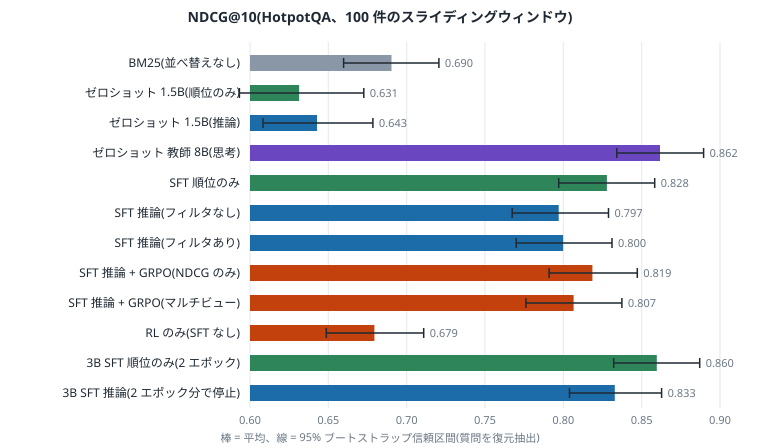
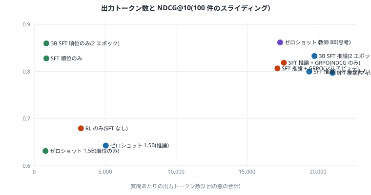

# ReasonRank: Empowering Passage Ranking with Strong Reasoning Ability

- 著者: Wenhan Liu, Xinyu Ma, Weiwei Sun, Yutao Zhu, Yuchen Li, Dawei Yin, Zhicheng Dou (中国人民大学 / Baidu / CMU)
- 年 / 会議: 2026 / ACL 2026 (arXiv:2508.07050)
- タグ: reranking, listwise, reasoning, GRPO, データ合成, 推論集約型 IR

## 一言でいうと

「推論してから順位を出す」リストワイズの reranker を作るレシピの論文です。学習データが足りない問題を、強い推論モデル (DeepSeek-R1、DeepSeek-AI, 2025) による自動合成で解き、学習は「推論の型を覚える cold-start SFT → 順位指標を報酬にした GRPO」の二段で行います。報酬は NDCG@10 だけでなく Recall@10 と RBO を足した multi-view 報酬で、スライディングウィンドウでの最終順位を良くすることをねらいます。7B で推論集約型ベンチマーク BRIGHT の平均 35.74 に達し、32B の既存手法 (Rank-K 32.61) を上回ります。

## 背景・課題

- LLM のリストワイズ reranking は強く、さらに推論モデル (LRM) で「考えてから順位を出す」と良くなることが分かってきました。ただし、推論つきの reranker を学習する**データが足りません**。既存の学習データ (MS MARCO など) の質問は、推論が要らないものが大半です。
- 既存の推論つき reranker は、順位を出す単位が違います。Rank1 (Weller et al., 2025) は pointwise (1 文書ごとに推論するので遅い)、Rank-R1 (Zhuang et al., 2025) は setwise で、いずれも reranking の本来の形 (リスト全体を見比べる) から外れています。
- 100 件を 20 件の窓で動かすスライディングウィンドウでは、**窓の中の NDCG が高くても、最終順位の NDCG が高いとは限りません**。関連文書を次の窓へ運べるかが効くためです (Fig. 2、§4.2)。

## 提案手法

**1. 推論集約型の学習データを自動合成 (約 13K 件)**

4 つの領域から、質問と、20 件以内の文書リストを作ります。

| 領域 | 質問・文書の出どころ |
|---|---|
| StackExchange 系 | 質問と回答を使い、検索で候補を集める。正例の選別と、ハード負例の選別に R1 を使う |
| コーディング | LeetCode の問題。解法の近い問題が正例になる。E5-Mistral で 40 件集め、R1 で正例を選ぶ |
| 数学 | ProofWiki などのコーパス。同じ手順 |
| Web 検索 | MS MARCO |

文書リスト (最大 20 件。窓の幅と同じ) に対し、R1 でリストワイズの順位付けをして、**推論の連鎖 (`<think>…</think>`) と正解順位**を得ます。正解の答えは教師に見せません (推論が答えに寄りかからないようにするため)。得られるラベルは 2 種類です。pointwise の二値 (正例 1、負例 0) と、リストワイズの正解順位つき推論です。

**自己整合性フィルタ**: R1 の出力順位を、正例・負例のラベルと突き合わせ、NDCG@10 が閾値を満たすものだけを SFT に使います。

**2. 二段階の学習**

- **cold-start SFT**: 上のリストワイズの出力 (`<think>…</think><answer>[3] > [1] > …</answer>`) を教師にして、通常の SFT をします (7B: lr 5e-6、5 epoch、思考の長さは最大 3072)。
- **GRPO** (Shao et al., 2024): 窓ごとに 8 個の出力をサンプルし、報酬をグループ内で正規化して方策勾配で更新します (200 ステップ、バッチ 16、lr 1e-6、出力は最大 3072)。

**3. multi-view 報酬**

R_m = NDCG@10 + φ·Recall@10 + γ·RBO(φ = 0.2、γ = 0.1)。RBO (Rank-Biased Overlap、Webber et al., 2010) は、出力順位と正解順位の全体的な近さを測る指標です。窓の中の NDCG@10 だけでは、窓の外へ関連文書を運ぶ力を測れないため、その補いとして Recall と RBO を足します。形式の報酬もあり、`<think>` と `<answer>` の形式がどちらも正しいときだけ R_m を与え、答えの形式だけが誤りなら 0 にします (それ以外の崩れ方の値は、取得した本文からは読み取れていません)。

**4. 推論時**: 上位 100 件を、窓 20・刻み 10 で後ろから前へ並べ替えます (Fig. 2)。

## 実験と結果

BRIGHT (推論集約型、Su et al., 2025) と R2MED (医療、Li et al., 2025) で、上位 100 件を並べ替えたときの NDCG@10 です (Tab. 1、2)。初期検索は、BRIGHT が ReasonIR (8B、Shao et al., 2025)、R2MED が E5-Mistral (7B、Wang et al., 2024) です。

| 手法 | BRIGHT 平均 | R2MED 平均 |
|---|---|---|
| RankZephyr (7B、非推論) | 22.64 | 22.58 |
| Rank1 (7B) | 27.23 | 32.30 |
| Rank1 (32B) | 28.34 | 39.13 |
| Rearank (7B) | 31.75 | 35.06 |
| Rank-K (32B) | 32.61 | 33.97 |
| **ReasonRank (7B)** | **35.74** | **39.53** |
| **ReasonRank (32B)** | **38.03** | **42.85** |

- 7B が、32B の既存手法を BRIGHT で約 3 点、R2MED で約 5.6 点上回ります (どちらも Rank-K (32B) 比)。R2MED では Rank1 (32B) (39.13) と同水準です。
- アブレーション (Tab. 3、BRIGHT、7B)

| 条件 | 平均 | 差 |
|---|---|---|
| ReasonRank (7B) | 35.74 | - |
| MS MARCO のみで学習 | 30.08 | −5.66 |
| 自己整合性フィルタなし | 34.20 | −1.54 |
| SFT なし (RL のみ) | 28.69 | −7.05 |
| RL なし (SFT のみ) | 33.15 | −2.59 |
| multi-view 報酬を NDCG のみに | 34.20 | −1.54 |
| 推論なし (SFT のみ / SFT + RL) | 32.96 / 33.60 | −2.78 / −2.14 |

- 従来型の BEIR (Thakur et al., 2021。7 データセット、BM25 から) でも、32B が 55.44 (BM25 比 +11.70) で最高です。
- 効率 (Fig. 5): リストワイズの ReasonRank は、pointwise の Rank1 より **2〜2.7 倍速い**。Rank1 は文書ごとに推論の連鎖を出すのに対し、ReasonRank は窓あたり 1 本の推論で済むためです。

## 実装メモ

`src/reasonrank_core.py` に、依存のない純 Python で中核を実装しました。プロンプトの組み立て、`<think>`/`<answer>` の解析 (壊れた出力の修復を含む)、NDCG@k・Recall@k・RBO、2 種類の報酬 (NDCG のみ / multi-view)、GRPO のグループ内正規化、スライディングウィンドウです。`tests/` に 13 件のテストがあります。

```bash
python -m venv .venv && source .venv/bin/activate
pip install -r requirements.txt
python -m pytest -q tests
```

実装上の取り決めは次のとおりです。

- RBO は、論文の式の打ち切り版 (窓の長さまで) を `1 − p^n` で割って、同じ順位なら 1 になるようにしました。p は論文が値を明記していないため 0.9 としています (仮定)。
- 形式が崩れた出力 (`<answer>` がない、識別子が欠ける・重複する) の報酬は 0 にしました。論文は形式の崩れ方で値を分けています。
- スライディングウィンドウは、先頭から数えて n=100、w=20、s=10 なら 9 回です。窓の外へは動かない性質をテストで確かめています。

## Modal での縮小再現 (HotpotQA × Qwen2.5-1.5B・3B、`reasonrank_mini/`)

論文の三つの主張 (推論つきリストワイズ reranking の効果、自己整合性フィルタ、GRPO と multi-view 報酬) を、小さなモデルと公開データで確かめる実験です。

### 設定

| 項目 | 論文 | この再現 |
|---|---|---|
| 学生モデル | Qwen2.5-7B / 32B-Instruct (Qwen Team, 2024) | Qwen2.5-1.5B-Instruct (全パラメータを学習)。追加で 3B-Instruct (SFT のみ。VRAM 80GB の GPU で、全パラメータを fp32 で学習) |
| 教師 | DeepSeek-R1 | Qwen3-8B (Yang et al., 2025。思考モード、温度 0.6、4 サンプル、最大 3072 トークン) |
| 学習データ | 4 領域、約 13K | HotpotQA (distractor) の 3,000 窓。正解 2 段落 + BM25 上位の負例 18 段落をシャッフル |
| 評価 | BRIGHT、R2MED | HotpotQA の dev (下記) |
| SFT | lr 5e-6、5 epoch | lr 1e-5、3 epoch、バッチ 8 |
| GRPO | 200 ステップ、バッチ 16、8 ロールアウト | 10 ラウンド × 96 窓、8 ロールアウト、lr 1e-6、ミニバッチ 8 窓、KL 項なし |

- **データ**: HotpotQA (Yang et al., 2018) の質問は、正解 2 段落を見つける課題として使えます。2 つ目の正解は質問文との語の重なりが小さいことが多く (橋渡しの推論が要る)、BM25 (Robertson & Zaragoza, 2009) だけでは取りこぼします。
- **評価**: 並べ替えの余地がある質問だけを使います。BM25 が正解 2 段落を 1・2 位に置けていない質問を、20 件の 1 窓 (300 問) と、100 件のスライディングウィンドウ (200 問、窓 20・刻み 10) で評価します。取りこぼした正解も、NDCG と Recall の分母に入れます。
- **自己整合性フィルタ**: 教師のサンプル 4 つのうち、形式が正しく NDCG@10 が 0.9 以上のものを、質問ごとに 1 つ残します。3,000 窓のうち 2,795 窓が通りました (教師の形式の正しさは 89.9%、平均 NDCG@10 は 0.940)。フィルタなしの版は、形式が正しいサンプルから 1 つ (2,989 窓) です。
- **デコード**: 推論つきのモデルは温度 0.6 のサンプリング、順位のみのモデルは貪欲です。後述のとおり、推論つきのモデルを貪欲で評価すると、同じ検討を繰り返して止まらなくなり、不当に低く出ます。
- 条件の定義は `reasonrank_mini/jobs.py`、実行は `reasonrank_mini/modal_app.py`、集計は `reasonrank_mini/make_figure.py`、全表は [`docs/tables.md`](docs/tables.md) にあります。

### 実行

```bash
modal run reasonrank_mini/modal_app.py --stage prepare                    # データ作成(CPU)
modal run reasonrank_mini/modal_app.py --stage teacher                    # 教師の推論つき順位のサンプルと、SFT データの作成
modal run reasonrank_mini/modal_app.py --stage run --jobs zs_direct,zs_cot,zs_teacher
modal run reasonrank_mini/modal_app.py --stage run --jobs sft_direct,sft_reason,sft_reason_nofilter
modal run reasonrank_mini/modal_app.py --stage run --jobs grpo_multi,grpo_ndcg,rl_only
modal run reasonrank_mini/modal_app.py --stage run --jobs sft_direct_3b --skip-eval   # 3B。--skip-eval で評価を省く
python reasonrank_mini/make_figure.py                                     # docs/ の図と表を作る
```

- 学習のログは、その場で流れます。SFT は、エポックごとに途中の checkpoint (`<名前>_ep<n>`) を保存し、5 分ごとに Volume へ commit します。課金の上限などで途中で止まっても、保存済みの checkpoint は残り、評価できます (3B の推論ありは、この形で 2 エポック分を評価しました)。
- 別のワークスペースで動かすときは、環境変数 `RR_NO_SECRET=1` を付けます (公開モデルの取得だけなら、Secret は要りません)。`modal run` のローカルプロセスは、完了まで生かしておきます。
- 再現に要する GPU 時間の目安 (Modal、VRAM 80GB の GPU): 教師データの生成 約 2 時間、1.5B の SFT 約 1 時間 (推論あり)、GRPO 1 本 約 1〜2 時間、評価 1 条件 約 3〜15 分、3B の SFT 約 0.9 時間 (順位のみ、2 エポック。評価を含む)、約 1.9 時間 (推論あり、3 エポックの見積もり)。1.5B の全条件の合計は、約 17 GPU 時間でした。

### 結果





100 件のスライディングウィンドウでの NDCG@10 です (BM25 のままは 0.690)。

| 条件 | NDCG@10 (95% 区間) | 無効な出力 (窓あたり) | 出力トークン/質問 |
|---|---|---|---|
| ゼロショット 教師 8B (思考) | 0.862 [0.834, 0.890] | 0.15 | 17,334 |
| SFT 順位のみ | 0.828 [0.797, 0.858] | 0.00 | 855 |
| SFT 推論 + GRPO (NDCG のみ) | 0.819 [0.791, 0.847] | 0.27 | 17,593 |
| SFT 推論 + GRPO (multi-view) | 0.807 [0.776, 0.837] | 0.22 | 17,139 |
| SFT 推論 (フィルタあり) | 0.800 [0.770, 0.831] | 0.36 | 19,379 |
| SFT 推論 (フィルタなし) | 0.797 [0.767, 0.829] | 0.31 | 21,019 |
| ゼロショット 1.5B (推論) | 0.643 [0.608, 0.678] | 0.69 | 5,047 |
| ゼロショット 1.5B (順位のみ) | 0.631 [0.593, 0.673] | 0.50 | 798 |
| RL のみ (SFT なし) | 0.679 [0.649, 0.711] | 0.03 | 3,296 |

区間は、評価の質問を復元抽出して平均を取り直した 95% ブートストラップ区間です。差の区間は、同じ質問での差を使います。

論文の主張との対応は次のとおりです。

| 論文の主張 | この再現 | 判定 |
|---|---|---|
| SFT なしの RL のみは大きく劣る (−7.05) | RL のみは BM25 と同等 (0.679)。SFT 推論より −0.12 | 再現 |
| 自己整合性フィルタは効く (−1.54) | フィルタあり − なし = +0.003 [−0.019, +0.025] | 再現できず (差がない) |
| 推論ありが推論なしより良い (−2.78 / −2.14) | 順位のみ − 推論あり = +0.028 [+0.004, +0.052] | 逆の向き |
| GRPO は SFT より上がる (−2.59) | NDCG のみ +0.019 [−0.003, +0.042]、multi-view +0.007 [−0.016, +0.030] | 向きは同じ、有意ではない |
| multi-view 報酬は NDCG のみより良い (−1.54) | multi-view − NDCG のみ = −0.012 [−0.037, +0.012] | 再現できず (差がない) |

GRPO の 2 つ目のシードでは、multi-view が 0.811、NDCG のみが 0.804 でした。1 つ目のシードとは順序が逆で、この 2 つの報酬の優劣は、この規模では区別できません。

### 3B での追加確認

サイズを上げると推論の利益が出るかを見るため、Qwen2.5-3B-Instruct で、推論あり・順位のみの SFT を 1 回ずつ行いました (教師データは 1.5B と共通。評価も同じで、推論ありは温度 0.6)。100 件のスライディングウィンドウでの NDCG@10 です (BM25 のままは 0.690)。

| モデル | NDCG@10 (95% 区間) | 無効な出力 (窓あたり) | 出力トークン/質問 |
|---|---|---|---|
| 3B 順位のみ (2 エポック) | **0.860** [0.832, 0.887] | 0.00 | 855 |
| 3B 推論あり (2 エポック分。下記) | 0.833 [0.804, 0.863] | 0.41 | 19,747 |
| 1.5B 順位のみ | 0.828 | 0.00 | 855 |
| 1.5B 推論あり (3 エポック) | 0.800 | 0.36 | 19,379 |
| 教師 8B (ゼロショット、思考) | 0.862 | 0.15 | 17,334 |

対応ありの差 (同じ質問での NDCG@10 の差) です。

| A | B | A − B |
|---|---|---|
| 3B 順位のみ | 3B 推論あり | +0.027 [+0.004, +0.050] |
| 3B 順位のみ | 1.5B 順位のみ | +0.032 [+0.014, +0.052] |
| 3B 推論あり | 1.5B 推論あり | +0.033 [+0.009, +0.057] |
| 3B 推論あり | 1.5B 順位のみ | +0.005 [−0.019, +0.030] |

- **3B でも、「推論ありが推論なしより良い」は再現しませんでした。** 3B にすると、推論ありも順位のみも、1.5B から同じだけ (約 +0.03) 上がるので、差は縮みません。無効な出力も 0.41 で、1.5B (0.36) から下がらず、推論を止められない問題は、サイズを上げても残りました。
- 3B の順位のみは、8B の教師 (0.862) と同等で、出力は約 20 分の 1 のトークン (855 対 17,334) です。
- **条件の違いに注意してください。** 3B の推論ありは、Modal のワークスペースが課金の上限で停止し、3 エポックの予定のうち 2 エポックの終わりのチェックポイントで評価しました (学習率の減衰が途中)。順位のみは、2 エポックを完走しています。いずれも SFT 1 回の実行で、3B の GRPO、フィルタ、報酬の比較は行っていません。
- 「論文が誤り」とも、「小さいモデルでは成り立たない」とも言えません。論文の最小は 7B で、題材も、推論が深く要る BRIGHT などです。この実験が示すのは、HotpotQA、この学習量、3B までの範囲です。

### 分かったこと

- **推論は、この規模 (1.5B、3B) では効きませんでした。** 1.5B は思考が長引き、同じ検討を繰り返して上限 (3,072 トークン) まで止まらないことがあります。無効な出力のうち 96% が、打ち切りによるものでした。出力の上限を 6,144 に広げても、無効な出力は 70% のままで、長さの問題ではなく、止められないことが原因です。一方、教師 8B は思考だけで 0.862 に届きます。推論の力は、モデルが十分に大きいときに出ると見ています (論文の最小は 7B)。
- **評価のデコードが結果を左右します。** 訓練中のロールアウト (温度 1.0) では無効な出力が 3〜8% なのに、貪欲デコードでは 23〜70% でした。温度 0.6 に直すと 8〜16% (1 窓) に下がりました。推論つきのモデルを貪欲で評価すると、不当に低く出ます。
- **費用は大きく違います。** 順位のみは、質問あたり 855 トークンで、推論つきは約 2 万トークンです (24 倍)。
- **評価の揺れに注意が要ります。** 同じモデルを温度 0.6 で再評価したところ、GRPO の 2 条件の NDCG@10 が 0.822 と 0.794 から、0.807 と 0.819 に入れ替わりました (サンプリングの揺れ)。最初の評価だけで「multi-view が良い」と判断すると、誤りになります。

### この実装がカバーしない範囲

- 7B 以上のモデルと、BRIGHT・R2MED での再現はしていません。論文の「7B が 32B を上回る」は確かめていません。確認したのは、1.5B と 3B (SFT のみ) までです。
- 3B の推論あり SFT は、3 エポックの予定のうち 2 エポック分で停止しています。3B の GRPO、フィルタ、報酬の比較は、行っていません。
- 学習データは HotpotQA の 3,000 窓だけです。論文の 4 領域 (約 13K) の多様性の効果 (MS MARCO のみで −5.66) は確かめていません。
- GRPO は 10 ラウンド (約 1,000 窓) で、論文 (約 3,200 窓) より短いです。KL 項も使っていません。
- SFT は 1 回だけの実行で、シードの揺れを見ていません (GRPO は 2 シード)。
- 評価は 200〜300 問で、0.02 以下の差は区別できません。
- pointwise の推論つき reranker (Rank1) との効率比較は、実装していません。

## 所感・疑問点

- 「推論ありが良い」という主張は、モデルの大きさに強く依存すると感じました。1.5B では、推論の長さの制御 (止めどころ) が先に壊れます。3B に上げても、止められない割合は下がりませんでした (0.36 から 0.41)。止めどころの学習は、サイズだけでは解けず、7B 以上や、より多い・難しいデータが要るのかもしれません。論文の SFT は、思考の長さを最大 3072 トークンに切っていますが、この制約で学習したモデルが、本番でどれだけ止まるのかは、論文からは分かりません。
- 順位のみのモデルが 24 倍安く、推論つきより高い (この規模で) という結果は、「リストワイズ reranker はまず、順位だけを学習させて、推論は、十分に大きいモデルで足す」という順序を示唆します。ただし、HotpotQA は、2 段の橋渡しという狭い推論です。BRIGHT のような、より深い推論が要る課題では、結論が変わる可能性があります。
- multi-view 報酬の効果は、この規模では確かめられませんでした。窓の外へ関連文書を運ぶ効果は、100 件のスライディングで見る必要があり、評価の質問数をもっと増やさないと差が見えません。
- 自己整合性フィルタが効かなかった理由は、教師のサンプルの質が高く (平均 NDCG@10 0.940、2,795 / 3,000 が閾値を通過)、フィルタがほとんど何も落とさなかったためだと見ています。論文の R1 のサンプルは、もっと難しい質問で、質にばらつきがあるはずです。

## 参考

- 論文: Wenhan Liu, Xinyu Ma, Weiwei Sun, Yutao Zhu, Yuchen Li, Dawei Yin, Zhicheng Dou. *ReasonRank: Empowering Passage Ranking with Strong Reasoning Ability*. ACL 2026. arXiv:2508.07050. https://arxiv.org/abs/2508.07050
